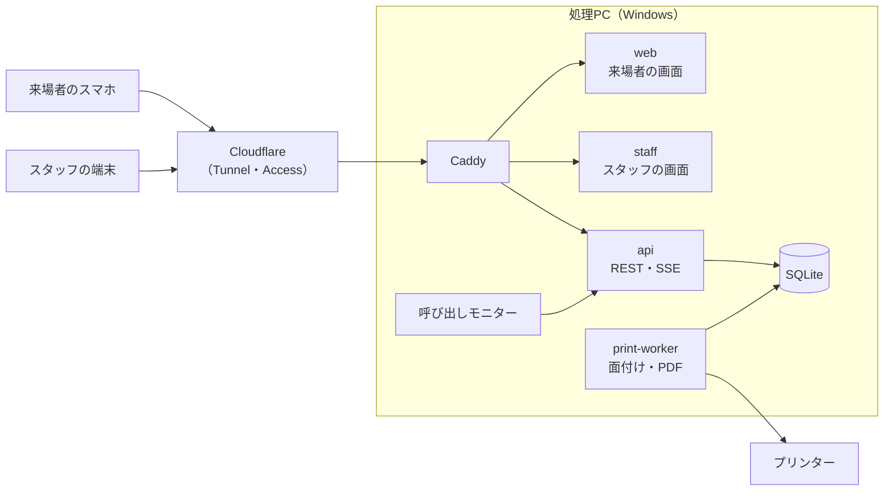

# canbadge-order-system

学祭のオリジナル缶バッジ注文・印刷・呼び出しシステム。

来場者がスマホでバッジをデザインして注文し、ブースで支払う。処理PCが自動で面付け・印刷し、スタッフが組み立てて番号で呼び出す。学祭まで約1ヶ月のため、**期日までに動くものを出すことが最優先**。

| 資料 | 内容 |
| --- | --- |
| [docs/setup.md](docs/setup.md) | 環境構築、日々の作業の流れ、Claude Code の使い方 |
| [CONTRIBUTING.md](CONTRIBUTING.md) | PR を出すまでの流れと、守ること（最小限のルール） |
| [docs/spec.md](docs/spec.md) | 仕様書（構成・状態遷移・データモデル） |
| [docs/tasks.md](docs/tasks.md) | タスク一覧と解説。「全体のつながり」の章にデータの形と API の叩き台がある |
| [design.md](design.md) | 全画面に共通するデザイン（配色・書体・余白・部品の決まり） |
| [infra/README.md](infra/README.md) | 本番（処理PC・Caddy・Cloudflare）の手順書の入口 |
| [Issues](https://github.com/sofken2/canbadge-order-system/issues) | タスク1件 = Issue 1件。タイトル先頭が tasks.md の ID |
| [Projects ボード](https://github.com/orgs/sofken2/projects/3) | 未着手 / 作業中 / レビュー待ち / 完了 |

## できること

### 来場者（スマホ）

- **はじめの画面**から、「注文する」「みんなの作品を見る」「自分の注文を確認する」を選ぶ
- **エディタ**でデザインする：写真（指で移動・拡大・回転）、文字、スタンプ、ペン、背景の色、フィルター。中央揃えと位置の戻しもできる
- **Discord のアイコン**を取り込んで、そのままバッジにできる（設定は [infra/discord.md](infra/discord.md)）
- **3D の完成予想**：缶バッジの形で、くるくる回して確かめられる。タップすると勢いよく回って正面で止まる
- **注文状況**：注文番号・確認コード・QR と、いまどこまで進んだかが、その場で更新される。画面を閉じても、注文番号と確認コードで開き直せる
- **みんなの作品**：公開された作品を見て、同じバッジを注文できる。作品だけを投稿・取り下げることもできる

### スタッフ（ブース）

- **レジ**：QR の読み取りか番号の入力で注文を開き、支払い済みにする
- **印刷確認**：刷り上がりをバッジごとに OK／再印刷で確認する
- **組み立て・受け渡し**：組み立てて完成にすると、呼び出しモニターに番号が出る。確認コードで本人を確かめて渡す
- **呼び出しモニター**：数メートル先から読める大きさで、できあがった番号を出す
- **設定・売上**：営業開始、受付の状態、印刷の一時停止、売上の集計
- **アーカイブの審査**：投稿された作品の承認・却下・非公開と、通報への対応

### 処理PC

- 支払い済みの注文を拾い、用紙に面付けして PDF を作り、プリンターで印刷する（**print-worker**）
- 寸法（見える円 58mm・印刷する円 70mm）と、プリンターの実測で決めた補正値は `packages/badge-spec` にある

## 全体の構成

本番は、Windows の処理PC 1 台で全部を動かし、Cloudflare Tunnel と Caddy を通して公開する。



| 分類 | 使っているもの |
| --- | --- |
| 実行環境・管理 | Bun、Turborepo（モノレポ） |
| 画面 | React、Vite、Konva（エディタ）、three.js（3D の完成予想） |
| API | Hono、SSE（注文状況とモニターの更新） |
| データ | SQLite、Drizzle、zod（契約の検証） |
| 品質 | TypeScript（strict）、Biome、bun test |
| 公開 | Cloudflare Tunnel・Access・Turnstile、Caddy |

## 今の進み具合

画面・API・印刷の実装（T・W・S・A・P のタスク）は、ひととおり終わっている。残りは、**本番の環境づくりと実機での確認**。

| Issue | 内容 |
| --- | --- |
| [#33](https://github.com/sofken2/canbadge-order-system/issues/33) I01 | 処理PCの構築 |
| [#35](https://github.com/sofken2/canbadge-order-system/issues/35) I03 | Cloudflare 設定 |
| [#36](https://github.com/sofken2/canbadge-order-system/issues/36) I04 | バックアップと復旧手順 |
| [#37](https://github.com/sofken2/canbadge-order-system/issues/37) Q01 | 設定値の確定 |
| [#38](https://github.com/sofken2/canbadge-order-system/issues/38) Q02 | 実機通しテスト |
| [#39](https://github.com/sofken2/canbadge-order-system/issues/39) Q03 | 回線断テスト（優先度低） |
| [#40](https://github.com/sofken2/canbadge-order-system/issues/40) Q04 | 運用リハーサル |

最新の状況は [Issues](https://github.com/sofken2/canbadge-order-system/issues) と [Projects ボード](https://github.com/orgs/sofken2/projects/3) を見る。

## すぐ動かす

必要なのは [Bun](https://bun.sh/)（と Git）だけ。Node を別に入れる必要はない。

```sh
# Bun が入っていなければ（Windows）。入れたあと、ターミナルを開き直す
powershell -c "irm bun.sh/install.ps1 | iex"

git clone https://github.com/sofken2/canbadge-order-system.git
cd canbadge-order-system
bun install          # 依存関係のインストール
bun run db:reset     # サンプルデータを入れる（初回と、データを作り直したいとき）
bun run dev          # web・staff・api・print-worker を起動する
```

詳しい手順（GitHub へのログインや Git の設定を含む）は、[docs/setup.md の第2部](docs/setup.md#第2部各自の初期設定)。

### 画面の URL

| 画面 | URL |
| --- | --- |
| 来場者：はじめの画面 | http://localhost:3000/ |
| 来場者：注文する | http://localhost:3000/order （エディタでデザイン → 注文の確認 → 注文すると、注文状況に移る） |
| 来場者：注文を開き直す | http://localhost:3000/lookup （注文番号と確認コード） |
| 来場者：みんなの作品（一覧・詳細・通報） | http://localhost:3000/archive |
| 来場者：作品を投稿する・自分の投稿（取り下げ） | http://localhost:3000/archive/post ・ http://localhost:3000/archive/mine |
| スタッフ：レジ（QR 読み取り・番号入力 → 確認 → 支払い済み） | http://localhost:3001/register （カメラは https か localhost のときだけ使える） |
| スタッフ：印刷確認 | http://localhost:3001/print |
| スタッフ：組み立て・受け渡し | http://localhost:3001/assemble |
| 呼び出しモニター | http://localhost:3001/monitor |
| スタッフ：設定（営業開始・受付状態・印刷の一時停止） | http://localhost:3001/settings |
| スタッフ：アーカイブの審査（承認・却下・非公開・通報） | http://localhost:3001/archive |

スマホで確かめるときは、同じ Wi-Fi から `http://<PC の IP>:3000/` を開く。PC のブラウザなら、開発ツール（F12 → Ctrl+Shift+M）でスマホの幅にして見られる。

### 注文から呼び出しまでの流れ

1. 来場者の画面で、写真を選んでデザインし、「注文の確認へ進む」→ 同意して「注文する」→ 注文番号と確認コードが出る（Turnstile のキー `TURNSTILE_SITE_KEY` を `.env` に入れていると、確認が通るまで押せない。localhost で試すときは、キーを空にするか、Cloudflare のテスト用キー `1x00000000000000000000AA` を使う）
2. レジで注文番号を入れて、支払い済みにする
3. print-worker が、印刷待ちを拾って PDF を作り、開発用ドライバーが `data/print-out/` に出力する（サンプルは、待ち時間 10 秒）
4. 印刷確認の画面で、バッジごとに OK か再印刷を選んで確認する
5. 組み立て・受け渡しの画面で、組み立て開始 → 完成。呼び出しモニターに番号が出る
6. 受け渡しで、来場者の確認コードを入れて、受け渡し済みにする

- サンプルデータには、**確認待ちの印刷シートが 1 枚**入っている。印刷中のシートは同時に 1 枚までなので、新しい注文を印刷したいときは、先にそのシートを印刷確認で確認する
- `packages/` の変更は、`bun run dev` を再起動すると反映される（`bun --watch` は、各 app の外のファイルを監視しない）
- `bun run db:reset` は、`data/` の DB を作り直す。試しに入れた注文は消える

### ポートと設定

| app | URL | ポート（`.env` の変数） |
| --- | --- | --- |
| web（来場者向け） | http://localhost:3000/ | 3000（`WEB_PORT`） |
| staff（スタッフ向け） | http://localhost:3001/ | 3001（`STAFF_PORT`） |
| api | http://localhost:3002/api/health | 3002（`API_PORT`） |
| print-worker | なし（ターミナルに起動のログだけ出る） | — |

- 設定は `.env.example` が既定値で、`.env` があれば上書きされる。`.env` がなくても動く。秘密の値（Discord・Turnstile のキーなど）は `.env` にだけ書く
- 処理PC の本番の設定（実プリンター・本番の URL・バックアップ先）は `.env.production`（ひな形は [infra/env.production.example](infra/env.production.example)）
- web と staff の画面は、`/api` を api のポートへ転送する。本番（Caddy 経由）と同じく、画面のコードは常に `/api` を呼べばよい
- api は契約（`packages/shared`）の全エンドポイントを実装している（構成は `apps/api/CLAUDE.md`）。スタッフ用の API は、Cloudflare Access の JWT を検証して通す。モニター用は、その PC の中（localhost）だけ

## 参加する開発者へ

### はじめにやること

1. [docs/setup.md](docs/setup.md) の第2部で環境を作る
2. [docs/spec.md](docs/spec.md) の 1〜8 章をざっと読む（全体像・識別子・業務フロー・状態遷移）
3. [docs/tasks.md](docs/tasks.md) の「全体のつながり」を読む。どのパッケージが何を渡し合うかが分かる
4. Projects ボードの「未着手」からタスクを選ぶ。初めてなら `good first issue` ラベルが付いたものがおすすめ

### タスクの選び方と進め方

1. Issue に「やります」とコメントし、自分を Assignees に追加する
2. 管理者が依存関係を確認して承認したら、ボードで「作業中」に移す
3. ブランチを切る：`<種別>/<IssueID>-<短い説明>`（例: `feat/W03-order-status`）
4. 早めに Draft PR を出す。本文に `Closes #<Issue番号>` を書く
5. 完成したら `gh pr ready` で Draft を解除し、ボードで「レビュー待ち」に移す

同時に持てるのは 1〜2 件まで。詳しいコマンドは [docs/setup.md の第3部](docs/setup.md#第3部日々の作業の流れ) を参照。

### ラベル

| ラベル | 意味 |
| --- | --- |
| `web` `staff` `api` `print` `infra` `shared` | 担当する領域（下の表） |
| `初級` `中級` `上級` | 難易度 |
| `good first issue` | 初参加の人向け |
| `実機` | スマホ・プリンター・処理PC などの実機での検証が必要。早めに着手する |
| `優先度低` | 本筋が完成してから着手（アーカイブ一式、回線断テスト） |

### 構成と担当タスク

| パス | 役割 | ラベル | 主なタスク |
| --- | --- | --- | --- |
| `apps/web` | 来場者向け（はじめの画面・注文・注文状況・アーカイブ） | `web` | W02〜W08 |
| `apps/staff` | スタッフ向け（レジ・印刷確認・組み立て・設定・モニター） | `staff` | S02〜S07 |
| `apps/api` | REST API と SSE（Hono on Bun） | `api` | T07、A01〜A06 |
| `apps/print-worker` | 面付け・PDF 生成・印刷 | `print` | P01〜P03 |
| `packages/shared` | 契約（zod スキーマ・ステータス・遷移表・API 型・SSE イベント型） | `shared` | T04 |
| `packages/db` | SQLite + Drizzle、状態遷移関数 | `shared` | T05 |
| `packages/fixtures` | 共通サンプルデータとシード | `shared` | T06 |
| `packages/badge-spec` | 寸法・解像度・面付けの設定値 | `shared` | T08、Q01 |
| `packages/ui` | デザイントークンと共通 UI 部品（`design.md` に従う） | `shared` | T10 |
| `packages/api-client` | 型付きの API クライアント。契約の `endpoints` から作り、web・staff が `/api` を呼ぶのに使う | `shared` | T09 |
| `packages/e2e` | 通し確認と負荷テスト。api と print-worker を実際に起動して、注文から受け渡しまでを通す（`bun run test` に含まれる）。負荷テスト（`bun run load`・Q04）は、模擬の来場者とスタッフを動かして、処理能力と詰まる所を測る（`packages/e2e/CLAUDE.md`） | `shared` | T09・Q04 |
| `packages/editor` | キャンバスエディタと 3D の完成予想 | `web` | W01 |
| `packages/scanner` | カメラでの QR 読み取り | `staff` | S01 |
| `infra/` | Caddy・cloudflared 設定、Windows 起動スクリプト、手順書 | `infra` | I01〜I04 |

各タスクが何を使い、何を誰に渡すかは、[docs/tasks.md](docs/tasks.md) の各タスク解説の「つながり」と、各 Issue 本文に書いてある。

### 守ってほしいルール

詳しくは [CLAUDE.md](CLAUDE.md)。人が開発する場合も同じルールで進める。

- **型・ステータス・API の形は `packages/shared` にだけ定義する。** 画面や API 側で独自に定義しない。変えたいときは管理者（契約オーナー）に相談する
- **状態の変更は `packages/db` の遷移関数を通す。** status 列を直接 UPDATE しない
- **ダミーデータは `packages/fixtures` のものを使う。** 画面は最初から `apps/api` を呼ぶ
- **寸法は `packages/badge-spec` の mm 値を使い、px への換算は用意された関数を通す**
- **本番は Windows。** パスは `node:path` で組み立て、シェル固有のコマンドに依存しない
- **金額は円の整数で扱う**
- **画面の見た目は `design.md` と `packages/ui` のトークンに従う。** デザインのルールは Hallmark（[docs/spec.md 6.4](docs/spec.md)）。色や書体を画面ごとに決めない。スマホの幅（320〜414px）で、横にはみ出さないことを確かめる
- **秘密情報をコミットしない。** `.env` に置き、`.env.example` にキー名だけを書く
- `main` に直接 push しない。PR は Squash merge でマージされる

### コマンド

```sh
bun install          # 依存関係のインストール
bun run dev          # 全 app を開発モードで起動
bun run typecheck    # 型チェック（全パッケージ）
bun run lint         # lint（Biome）
bun run test         # テスト（bun test。通し確認 packages/e2e を含む）
bun run build        # ビルド
bun run format       # コードの整形
bun run db:reset     # DB を作り直して、サンプルデータを入れる（data/ に作られる）
bun run backup       # DB と画像のバックアップ（処理PC。手順は infra/backup.md）
bun run restore      # バックアップからの復旧（同上）
```

PR を出す前に `typecheck`・`lint`・`test` を通す。特定のパッケージだけ実行するときは `bunx turbo run <task> --filter=@canbadge/<名前>`（例：`bunx turbo run test --filter=@canbadge/api`）。

- 整形と lint は Biome。保存時に整形されない場合は `bun run format` を実行する
- 画面は Vite + React（SPA）で、Bun で動かす（`bunfig.toml` で vite や tsc も Bun で実行する）

### 困ったとき

- 手順どおりに動かない → [docs/setup.md の「よくあるトラブル」](docs/setup.md#よくあるトラブル)。直したら setup.md を直す PR を出す
- `bun` が見つからない → Bun を入れたあと、ターミナルを開き直す（PATH が反映されるのは、新しく開いたターミナルから）
- 仕様が分からない・仕様と矛盾しそう → 実装する前に Issue にコメントして相談する
- 契約（`packages/shared`）を変えたくなった → 自分で変えずに管理者に相談する
- 作業が止まっている → 1週間動きがないタスクはアサインを外すことがある。止まりそうなら早めにコメントで知らせる

## コントリビューター

このシステムを作っている人たちは、[Contributors のページ](https://github.com/sofken2/canbadge-order-system/graphs/contributors)で見られる。コミットの作者のメールアドレスを、自分の GitHub アカウントに登録しておくと、ここに載る。
