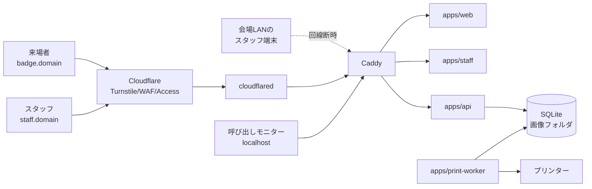
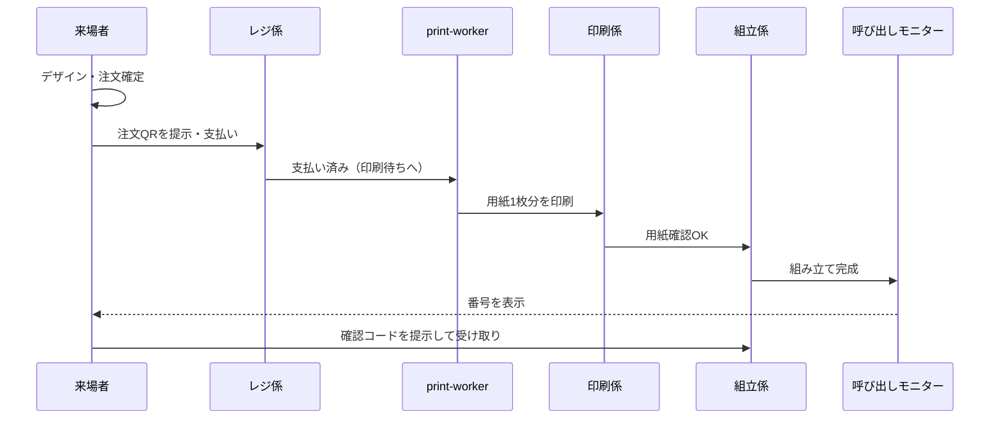
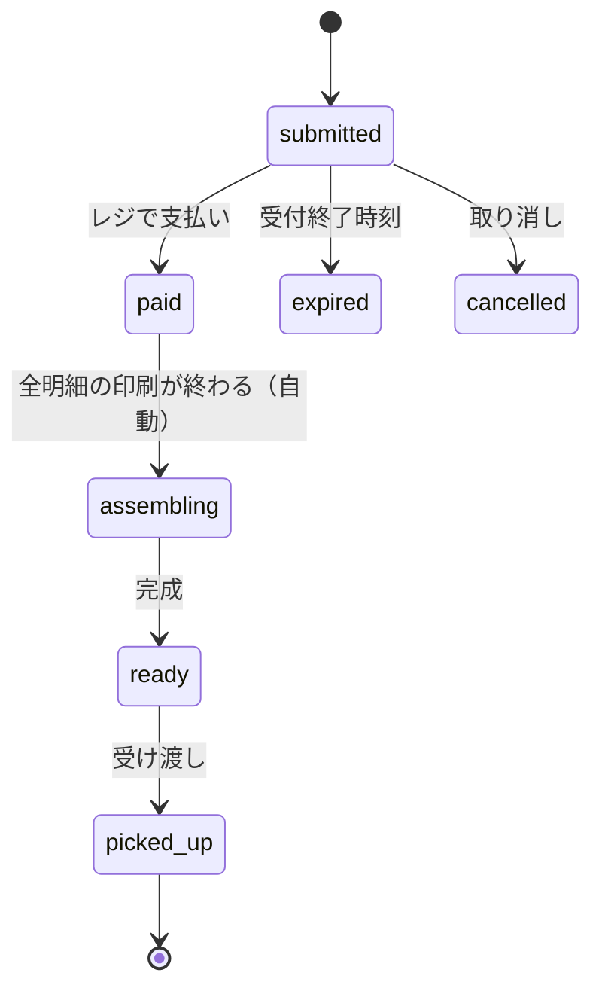
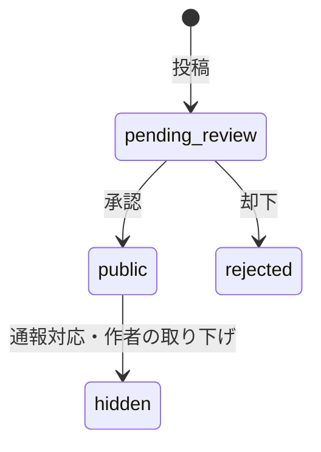
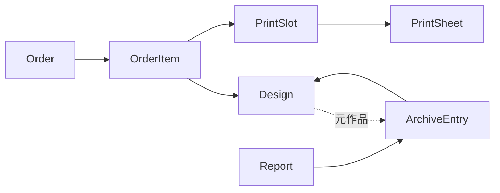

# 学祭 缶バッジ注文システム 仕様書

版数 v0.2（設計段階。営業日・受付状態・支払い・返金・印刷履歴と再印刷の決定を反映）。タスク一覧と各タスクの解説は [tasks.md](tasks.md) を参照。

## 1. 概要

来場者がWebでオリジナル缶バッジをデザイン・注文し、ブースで支払い、印刷後にスタッフが手作業で組み立てて呼び出す仕組みを作る。

**スコープ**

- Web上での簡易デザイン編集
- 注文の受付と、ブースでの支払い（オフライン）の記録
- 印刷の自動化（面付け・印刷キュー）
- 組み立て・受け渡しの進捗管理と呼び出し
- デザインのアーカイブ公開と、他の来場者による再注文

**スコープ外**

- オンライン決済
- アクセス元の場所による制限
- 来場者のアカウント登録

**前提条件**

- 処理PCは Windows 1台。プリンターは Canon PIXUS TS6730（USB接続）
- 外部公開は Cloudflare Tunnel 経由。独自ドメインを用意する
- 寸法・価格などの数値は設定値として外に出し、本書では確定しない（15章）

## 2. 決定事項一覧

設計の議論で確定した事項は次のとおり。

| 項目 | 決定内容 | 理由 |
| --- | --- | --- |
| 実行環境 | 処理PC（Windows）1台に全プロセスを配置 | 運用対象を1台に集約する |
| 外部公開 | Cloudflare Tunnel（外向き接続のみ） | ポート開放不要。大学ネットワークでも動かしやすい |
| 入口 | 処理PC内のリバースプロキシ（Caddy）に一本化 | Cloudflare経由と会場LAN経由で同じ経路にする |
| リポジトリ | Bun + Turborepo のモノレポ | apps/packages 単位で複数人が分担開発する |
| DB・保存 | SQLite ＋ ローカルの画像フォルダ | 1台構成に適し、バックアップがファイルコピーで済む |
| 決済 | オフライン・先払い（支払い後に印刷） | 未払い・いたずら注文で資材を無駄にしない |
| 場所制限 | 設けない | 先払いのため遠方からの注文に実害がない。事前デザインで混雑も緩和 |
| 乱用対策 | 支払い待ちの期限・件数上限、Turnstile、レート制限 | 場所制限の代替 |
| スタッフ認証 | Cloudflare Access（LAN経由時は簡易PIN） | 認証を自作しない |
| レジ | スマホカメラで注文QRを自動読み取り＋注文番号入力 | 専用アプリ不要。機材がなくても運用できる |
| 印刷 | PDF生成 → SumatraPDF（拡大縮小なし） | 寸法を崩さずに印刷する |
| 印刷完了判定 | スタッフが用紙を目視確認して確定 | スプーラーの状態は信頼できない場合がある |
| 呼び出し | 処理PC直結モニター＋注文状況ページの自動更新 | 回線断時もモニター表示は継続する |
| アーカイブ | 任意投稿、権利確認への同意必須、スタッフ承認制 | 著作権・肖像権のリスクを抑える |
| UI デザイン | Hallmark（anti-AI-slop のデザインスキル）のルールに従い、共通のデザインを `design.md` に固定する（6.4） | 生成AIにありがちな画一的な見た目を避け、web と staff で統一感を出す |

**優先度の変更**：締切まで約1ヶ月のため、アーカイブ一式（11章）と回線断時の会場LAN運用（14章の該当行、13.1のPIN認証）は、本筋の完成後に余裕があれば実装する。回線断時は紙での注文受付で代替する。

## 3. システム構成

全プロセスは処理PC上で動き、外部からの通信はすべて Caddy を通る。

### 3.1 機材

| 機材 | 役割 | 接続 |
| --- | --- | --- |
| 処理PC（Windows） | 全プロセスの実行 | 有線LAN／インターネット |
| Canon PIXUS TS6730 | 印刷 | USB（処理PC） |
| 呼び出しモニター | 呼び出し画面の常時表示 | HDMI（処理PCの2画面目） |
| スタッフ端末（スマホ・タブレット） | レジ、印刷、組み立て・受け渡し、審査 | インターネット（回線断時は会場LAN） |
| 来場者のスマホ | デザイン、注文、注文状況の確認 | インターネット |

### 3.2 プロセスと通信経路

Caddy はホスト名で web と staff に振り分け、`/api/*` を api に渡す。ブラウザからは常に同一オリジンに `/api` があるように見えるため、CORS設定が不要で、Cloudflare経由とLAN経由でアプリのコードを変えずに済む。

### 3.3 プロセス一覧

| プロセス | 役割 | 起動方法 |
| --- | --- | --- |
| cloudflared | Cloudflare Tunnel の接続 | Windowsサービス |
| Caddy | 唯一の入口、振り分け、LAN経由時のPIN認証 | 専用ユーザーのログオン時にタスクスケジューラで起動 |
| apps/web | 来場者向け画面 | 同上 |
| apps/staff | スタッフ向け画面 | 同上 |
| apps/api | REST API、SSE、画像配信 | 同上 |
| apps/print-worker | 面付け・PDF生成・印刷 | 同上 |

Bunのプロセス群をSYSTEMアカウントのサービスにしないのは、プリンターの既定設定がユーザー単位で保存され、SYSTEMからの印刷では反映されない場合があるため。処理PCは専用ユーザーで自動ログオンさせる。

## 4. リポジトリ構成（Bun + Turborepo）

apps は実行単位、packages は共有部品とし、担当者は apps/packages 単位で分担する。

| パス | 種別 | 役割 |
| --- | --- | --- |
| `apps/web` | アプリ | 来場者：エディタ、注文、注文状況、アーカイブ |
| `apps/staff` | アプリ | レジ、印刷、組み立て・受け渡し、審査、設定、呼び出しモニター |
| `apps/api` | アプリ | REST API、SSE、画像の保存と配信（Hono on Bun を想定） |
| `apps/print-worker` | アプリ | 面付け、PDF生成、印刷 |
| `packages/db` | 共有 | スキーマ、マイグレーション、状態遷移関数 |
| `packages/shared` | 共有 | 型、zod スキーマ、ステータス定義、識別子の形式 |
| `packages/fixtures` | 共有 | 共通サンプルデータとシード |
| `packages/editor` | 共有 | キャンバスエディタ部品 |
| `packages/scanner` | 共有 | カメラによるQR読み取り部品 |
| `packages/badge-spec` | 共有 | 寸法・解像度・面付けの設定値 |
| `packages/ui` | 共有 | 共通UIコンポーネントとデザイントークン（`design.md` に従う） |
| `packages/config` | 共有 | tsconfig、lint 設定 |
| `infra/` | 運用 | Caddy・cloudflared 設定、Windows 起動スクリプト、復旧手順書 |

**方針**

- ステータス定義・バッジ寸法・状態遷移は packages に集約し、apps 間での食い違いを防ぐ
- `print-worker` の印刷処理はインターフェースで抽象化し、開発用（PDFをフォルダに出力）と本番用（SumatraPDF）を切り替える。Windows以外の環境でも開発できるようにするため
- `infra/` をリポジトリに含め、予備機への切り替えをリポジトリの取得から再現できるようにする

## 5. 識別子

機械が扱う推測不可能なIDと、人が扱う短い番号を分ける。

| 識別子 | 形式 | 用途 |
| --- | --- | --- |
| 注文ID | 推測できない長いID（ULID等） | 注文QRの中身、注文状況ページのURL、内部参照 |
| 注文番号 | 営業日ごとにリセットする短い連番（桁数は設定値）。営業日はスタッフの「営業開始」操作で決まる | レジでの番号入力、呼び出し表示、用紙への印字 |
| 確認コード | 紛らわしい文字（`0` `O` `1` `I` `L`）を除いた英大文字・数字 4 文字 | 受け渡し時の本人確認、端末を変えた人の注文照会 |
| 匿名トークン | ブラウザのCookieに保存するランダム値 | 来場者本人の注文・投稿の識別 |

- 注文番号は日付と組み合わせて内部で一意にする。レジでの番号検索は「当日の支払い待ちの注文」に限定するため、短い番号でも衝突しない
- QRに短い番号を入れないのは、番号の総当たりで他人の注文状況を閲覧されるのを防ぐため

## 6. 利用者と画面

来場者はアカウント登録なしで利用し、スタッフは役割別の画面をスマホで操作する。

### 6.1 来場者（apps/web）

| 画面 | 内容 |
| --- | --- |
| エディタ | プリクラ風。画像アップロード（端末の画像、または Discord のアイコンの取り込み）、拡大・回転・位置調整、テキスト、背景色、スタンプ、簡単なお絵描き、写真のフィルター。塗り足しと安全領域のガイド表示。途中保存はブラウザ内 |
| 注文確定 | 個数の指定（原則1個。上限が1なら選択なし）、Turnstile による確認、注文の確定。受付停止中は注文できない旨を表示 |
| 注文状況 | 注文QR（大きく表示）、その下に注文番号と確認コード、現在の状態（自動更新） |
| 注文照会 | 注文番号＋確認コードで注文状況を開く（端末を変えた人向け） |
| アーカイブ | 公開作品の閲覧、作品を元にした注文、自分の作品の投稿と取り下げ |

### 6.2 スタッフ（apps/staff）

権限は1種類とし、Accessを通過したスタッフは全画面を利用できる。

| 画面 | 担当 | 操作 |
| --- | --- | --- |
| レジ | レジ係 | カメラ常時起動でQRを自動読み取り、または注文番号を入力 → 確認画面（サムネイル・個数・金額・お釣り）→ 支払い済み |
| 印刷 | 印刷係 | 印刷待ちの確認。印刷の一時停止と再開（プリンターの失敗で、自動で止まったときも、ここで再開）。印刷済みバッジと印刷ジョブの履歴（サムネイル付き）から選んで、バッジごとに再印刷。印刷の確認の操作はない |
| 組み立て・受け渡し | 組立係・受け渡し係 | 組み立て中の注文の一覧から「完成」（印刷が終わると、自動で組み立て中になる。組み立て開始の操作はない）。受け渡しは番号で探して確認コードを照合 |
| 審査 | 審査係 | アーカイブ投稿の承認・却下、通報への対応 |
| 設定 | 責任者 | 営業開始・ビジー（混雑時の一時的な受付拒否）・受付終了、価格、各種上限、売上の集計。**データのリセット**（テストのあと・本番の前に、注文・売上・印刷の履歴・アーカイブを消す。受付終了中だけ。消す前に自動でバックアップし、確認の文字を打ち込ませる。設定の値は残す） |
| 呼び出しモニター | —（表示専用） | 完成した注文番号の表示、サイトへの固定QR |

### 6.3 レジ画面の仕様

- 画面を開いている間はカメラを起動し続け、QRを検出したら自動で読み取る
- 読み取り成功時は振動と音で通知する
- QR読み取りと注文番号入力は同じ入力処理で受け付ける（ハンディスキャナーを後から接続しても同じ入力欄で動く）
- カメラが使えない状況（HTTP接続時、権限拒否時）はカメラ表示を隠し、番号入力のみで動作する
- QR解読はブラウザ標準機能に依存せず、ライブラリで行う（端末による対応差を避けるため）

### 6.4 UI デザインの方針

生成AIが作りがちな見た目（紫のグラデーション、どれも同じカード3枚の並び、意味のない絵文字や装飾、架空の数字など）を避け、人が設計したと分かる画面にする。

- デザインのルールには [Hallmark](https://github.com/nutlope/hallmark)（MIT ライセンスのデザインスキル）を使う。リポジトリの `.claude/skills/hallmark/` に同梱してあり、Claude Code をリポジトリ直下で起動すれば自動で読み込まれる
- 配色・書体・余白・角丸・動きは、プロジェクト直下の `design.md` に1つだけ定義して固定する。Hallmark は `design.md` があるとそれを最優先で使うので、画面ごとに見た目がばらつかない
- `design.md` の値は `packages/ui` のデザイントークン（CSS 変数）として実装し、web と staff はそれを参照する。画面側で色や書体を直接指定しない
- 新しい画面・部品は Hallmark の既定の流れで作り、既存の画面は `hallmark audit <対象>` で点検する
- 使いやすさを優先する。レジ・組み立て・呼び出しモニターはボタンと文字の大きさ、コントラスト、操作の少なさが先で、装飾は控える
- スマホの幅（320〜414px）で崩れないこと、色だけに頼らない表示、十分なコントラストは、Hallmark の点検項目に含まれる

Claude Code を使わずに開発する人は、`.claude/skills/hallmark/references/slop-test.md`（避けるべきパターンの一覧）と `design.md` を読んで同じ基準に合わせる。

## 7. 業務フロー

デザインから受け渡しまで8段階で進み、来場者がブースに来るのは支払いと受け取りの2回。

1. 来場者が web でデザインする（途中保存はブラウザ内）
2. 注文を確定すると、注文ID・注文番号・確認コードが発行される
3. レジで注文QRを読み取るか注文番号を入力し、支払いを受けて「支払い済み」にする。注文は自動で印刷待ちになる
4. print-worker が印刷待ちのバッジを用紙1枚分にまとめて印刷する。プリンターに印刷のジョブを送れたら、印刷の確認なしで、注文は自動で「組み立て中」になる（失敗したら、バッジは印刷待ちに戻り、印刷は一時停止して、印刷係が直して再開する）
5. 組立係が、組み立てて、完成したら「完成」を押す。用紙の不良に気づいたバッジは、履歴からバッジごとに、すぐ再印刷する
7. 呼び出しモニターに注文番号が表示され、来場者の注文状況ページも更新される
8. 受け渡し係が確認コードを照合して渡し、「受け渡し済み」にする

## 8. 状態遷移

印刷はバッジ（注文明細）単位、それ以外の工程は注文単位で状態を管理する。用紙1枚に複数注文のバッジが混在するため。

### 8.1 注文の状態

| 現在 | 次 | きっかけ | 実行者 | 付随処理 |
| --- | --- | --- | --- | --- |
| `submitted` | `paid` | 支払い済み操作 | レジ係 | 支払い日時を記録（現金のみ）、全明細を `queued` に |
| `submitted` | `expired` | 受付終了の操作、または次の営業開始 | 自動 | デザインを削除対象にする |
| `submitted` | `cancelled` | 取り消し操作 | 来場者・責任者 | — |
| `paid` | `assembling` | 全明細が `printed` になる（印刷のジョブを送れた） | 自動 | 印刷の確認と、組み立て開始の操作は、ない |
| `assembling` | `ready` | 完成 | 組立係 | 呼び出しモニターに表示 |
| `ready` | `picked_up` | 受け渡し | 受け渡し係 | 呼び出しモニターから削除 |
| `assembling`・`ready` | `paid` | 履歴からの再印刷 | 印刷係 | 明細を `queued` に戻す。`ready` なら呼び出しモニターから削除 |
| 支払い後の各状態 | `refunded` | 返金操作 | 責任者 | 全額返金のみ。返金日時を記録 |

### 8.2 注文明細の状態

| 現在 | 次 | きっかけ |
| --- | --- | --- |
| `queued` | `printing` | print-worker が印刷シートに載せて印刷 |
| `printing` | `printed` | ドライバーが印刷のジョブを送れた（自動）。注文の全明細が `printed` になれば、注文は `assembling` に進む |
| `printing` | `queued` | ドライバーが失敗した（自動）。印刷待ちに戻り、印刷は一時停止する |
| `printed` | `queued` | 印刷係が履歴からバッジごとに再印刷を選択（用紙の不良・組み立て中の破損など）。注文も `paid` に戻る |

### 8.3 遷移の規則

- 状態の変更はすべて `packages/db` の遷移関数を通し、上表にない遷移は拒否する
- スタッフによる操作は、実行者・日時・内容を操作ログに記録する

## 9. 印刷処理

print-worker が印刷待ちのバッジを用紙単位にまとめ、PDFを生成して SumatraPDF で印刷する。

### 9.1 キューの動作

- 数秒おきに `queued` の明細を確認する
- 再印刷の明細は優先して次のシートに載せる
- 再印刷の明細は、待ち時間が通常の半分（`REPRINT_WAIT_RATIO`）。起点は、印刷待ちに戻った時刻（`requeuedAt`。DB に記録する）で、支払いの時刻ではない。スタッフ画面は、同じ値で、印刷までの残り秒数を出す
- 印刷したシートと、そこに載ったバッジの記録はすべて残し、スタッフ画面から履歴として確認・再印刷できるようにする
- 用紙1枚分がたまったら即時印刷する。たまらなくても、最も古い明細が一定時間待ったらその時点の分で印刷する（個数と時間は設定値）
- 印刷中のシートは同時に1枚まで。印刷係の確認が済むまで次のシートを送らない
- 各バッジの横に注文番号を小さく印字し、組み立てと仕分けでの取り違えを防ぐ
- スタッフ画面から印刷を一時停止・再開できる（インク交換・用紙補充用）
- print-worker は SQLite を直接読むが、状態の変更は `packages/db` の遷移関数で行う

### 9.2 印刷方式

- 面付け済みのPDFを生成し、SumatraPDF のコマンドラインで印刷する。オプションで拡大縮小なし（`noscale`）を指定し、バッジの直径がずれないようにする
- 印刷品質・用紙種類などプリンター固有の設定は、Windows の印刷設定で既定値として固定する。設定違いが必要なら、同じプリンターを別名で登録する
- 寸法の較正用ページ（定規目盛と基準円）を用意し、実測したずれを補正値として `badge-spec` に持たせる

### 9.3 プリンター運用上の注意（PIXUS TS6730）

- インクは黒とカラー（3色一体）のカートリッジ2本。カラーは1色なくなると1本ごと交換になるため、予備を必ず用意する
- 残量はソフトから監視せず、一定枚数ごとの目視確認で運用する
- フチあり印刷を前提とする。印刷可能範囲の余白は実機のテスト印刷で決める
- 普通紙はカセット、厚紙・専用紙は後トレイから給紙する

## 10. リアルタイム通知

api から SSE（Server-Sent Events）で状態の変化を配信し、Caddy 経由でそのまま届ける。

| 購読者 | 受け取る内容 |
| --- | --- |
| 来場者の注文状況ページ | 自分の注文の状態変化 |
| スタッフの各画面 | 注文・印刷キュー・印刷シートの変化 |
| 呼び出しモニター | `ready` になった注文番号の追加と、受け渡し済みの削除 |

- SSE は「変化があった」ことを知らせる役割に留め、正しい状態は常に REST API から取得する
- 接続が切れた場合は自動で再接続し、再接続時に現在の状態を丸ごと取り直す
- Web Push 通知は任意の補助機能とし、呼び出しの手段としては依存しない（iPhoneではホーム画面への追加が必要なため）

## 11. アーカイブ

デザインの公開は任意投稿・スタッフ承認制とし、承認された作品だけを他の来場者が閲覧・注文できる。

### 11.1 投稿

- 注文とは独立して投稿できる（注文と同時に投稿するか、投稿だけ行うかを選べる）
- 投稿時は次の3点を必須とする：自作であることへの同意、他の来場者が注文してよいことへの同意、表示名（任意のニックネーム）の入力
- 同意の内容と日時を記録する

### 11.2 公開の状態

### 11.3 作品からの注文

- 元作品をコピーした新しいデザインとして注文する。元作品への参照と作者の表示名を保持する
- 元作品が非公開になった場合、支払い前のコピーからの注文を停止する
- 作者は、投稿した端末の匿名トークンで本人と判定され、作品を取り下げられる

### 11.4 リスクへの対応

既存キャラクターや他人の写真を含む画像の公開・複製販売は、著作権・肖像権の問題になり得る。承認制・同意の記録・通報機能・学祭終了後の公開停止で抑える。公開しない個人注文でも、持ち込み画像の権利確認への同意を注文時に求める。最終的な可否は学祭実行委員会・大学に確認する。

## 12. データモデル

主要エンティティは9つ。画像はDBに格納せず、画像フォルダに保存してパスのみを持つ。

| エンティティ | 主な属性 | 関連 |
| --- | --- | --- |
| Design | 印刷用画像のパス、編集データ（JSON）、作成日時 | 元になった ArchiveEntry（任意） |
| Order | 注文ID、営業日＋注文番号、確認コード、匿名トークン、状態、合計金額 | OrderItem（原則1つ） |
| OrderItem | 個数、状態、印刷回数、印刷待ちに戻った時刻 | Order、Design、PrintSlot（複数） |
| PrintSheet | PDFのパス、状態（印刷中／確認済み／失敗）、印刷日時 | PrintSlot（複数） |
| PrintSlot | シート上の位置、確認結果（未確認／OK／再印刷） | PrintSheet、OrderItem |
| ArchiveEntry | 表示名、状態、同意の記録、投稿者の匿名トークン | Design |
| Report | 通報理由、対応状況 | ArchiveEntry |
| Setting | 営業日、受付状態（受付中・ビジー・受付終了）、価格、各種上限、印刷の一時停止（1行だけのテーブル） | — |
| AuditLog | 実行者、日時、操作内容、対象 | 各エンティティ |

## 13. 認証・乱用対策

スタッフは経路に応じて Cloudflare Access か簡易PINで認証し、来場者側は認証なしの代わりに入口で乱用を抑える。

### 13.1 認証

| 利用者 | 経路 | 認証方式 |
| --- | --- | --- |
| 来場者 | Cloudflare経由 | なし（匿名トークンで本人の注文・投稿を識別） |
| スタッフ | Cloudflare経由（staff.domain） | Cloudflare Access（メールのワンタイムコード等） |
| スタッフ | 会場LAN経由（回線断時） | Caddy の前段で簡易PIN認証 |
| 呼び出しモニター | localhost | 表示専用のため不要 |

api はスタッフ用APIについて、Access を通過したリクエストか PIN 認証済みのリクエストのみを受け付ける。来場者用ドメインからはスタッフ用APIを呼べない。

### 13.2 乱用対策

- 支払い待ちの注文は受付終了の操作で失効する（操作が漏れても次の営業開始で失効する）
- 1端末（またはIP）あたりの支払い待ち注文数に上限を設ける
- 注文確定時に Cloudflare Turnstile でボットを判定する
- Cloudflare の WAF・レート制限で API への過剰なアクセスを入口で止める
- アップロード画像の容量と形式を制限する
- 注文の受付はスタッフが受付状態（受付中・ビジー・受付終了）で制御する。受付中以外もデザイン作成とアーカイブ閲覧は可能

### 13.3 データの取り扱い

- 失効した注文のデザインは削除する
- 学祭終了後、アーカイブの公開を停止し、画像データの保存期間を過ぎたら削除する（期間は15章）

## 14. 異常時の運用

状態はすべて SQLite にあり、処理PCが会場にあるため、インターネットが切れてもレジ・印刷・呼び出しは継続できる。

| 状況 | 挙動・対応 |
| --- | --- |
| 注文が処理能力を超える | 責任者がビジーに切り替えて新規注文だけを断る。デザインと、支払い済み注文の処理は継続。web に案内文と現在の待ち件数を表示 |
| インターネット回線の切断 | スタッフ端末は会場LANから `http://<処理PCのIP>` に接続し、PIN認証で staff を利用。レジは番号入力のみ（HTTPではカメラが使えないため）。呼び出しモニターは影響なし。新規注文はスタッフ端末から代理入力 |
| 処理PCの再起動 | 起動時に全プロセスを自動起動し、そのまま再開。`printing` のまま残ったシートは印刷係の確認待ちとして表示 |
| 処理PCの故障 | 予備機でリポジトリ（`infra/` 含む）とバックアップから復旧。手順は事前にリハーサルする |
| プリンターの不調・インク切れ | 印刷を一時停止し、対処後に再開。失敗した用紙は再印刷 |
| 来場者が取りに来ない | `ready` のまま保持。一定時間を超えたものをスタッフ画面で強調表示 |

### 14.1 事前に行う設定

- Windows Update の一時停止（学祭期間中の自動再起動を防ぐ）
- スリープ・画面ロックの無効化、電源プランの固定
- SQLite と画像フォルダの定期バックアップ（外付けドライブ等）
- 可能であれば UPS（無停電電源装置）の設置
- 大学の学内ネットワーク利用規程の確認と、cloudflared の通信が通ることの事前確認

## 15. 未決事項・設定値

以下はすべて `Setting` または `badge-spec` の値であり、構成と挙動には影響しない。

### 15.1 設定値（後で確定）

| 設定値 | 保存先 | 決定に必要な情報 |
| --- | --- | --- |
| バッジの寸法・塗り足し・安全領域 | badge-spec | 使用するバッジマシンとパーツのテンプレート |
| 印刷解像度 | badge-spec | 300〜600dpi の範囲で実機テスト |
| 1枚あたりの面付け数 | badge-spec | 寸法と印刷可能範囲 |
| 印刷寸法の補正値 | badge-spec | 較正用ページの実測 |
| 印刷待ちの最大時間 | Setting | 想定注文数 |
| 価格 | Setting | 材料費。現金のやり取りを減らす価格設定を推奨 |
| 1注文あたりの個数上限 | Setting | 原則1。面付け数を超えないこと |
| 端末あたりの支払い待ち上限 | Setting | — |
| 画像の容量上限 | Setting | — |
| 注文番号の桁数 | Setting | 1日の想定注文数 |
| 画像データの保存期間 | Setting | 実行委員会の方針 |

### 15.2 確認が必要な事項

- [ ] 学祭実行委員会：物品販売の許可、アーカイブ公開の可否
- [ ] 大学：学内ネットワークから外部公開サービスを運用してよいか
- [ ] 使用するバッジマシンとバッジサイズ
- [ ] 使用する用紙
- [ ] 独自ドメインの用意
- [ ] アーカイブ作品からの注文時に、デザインの編集を許可するか
