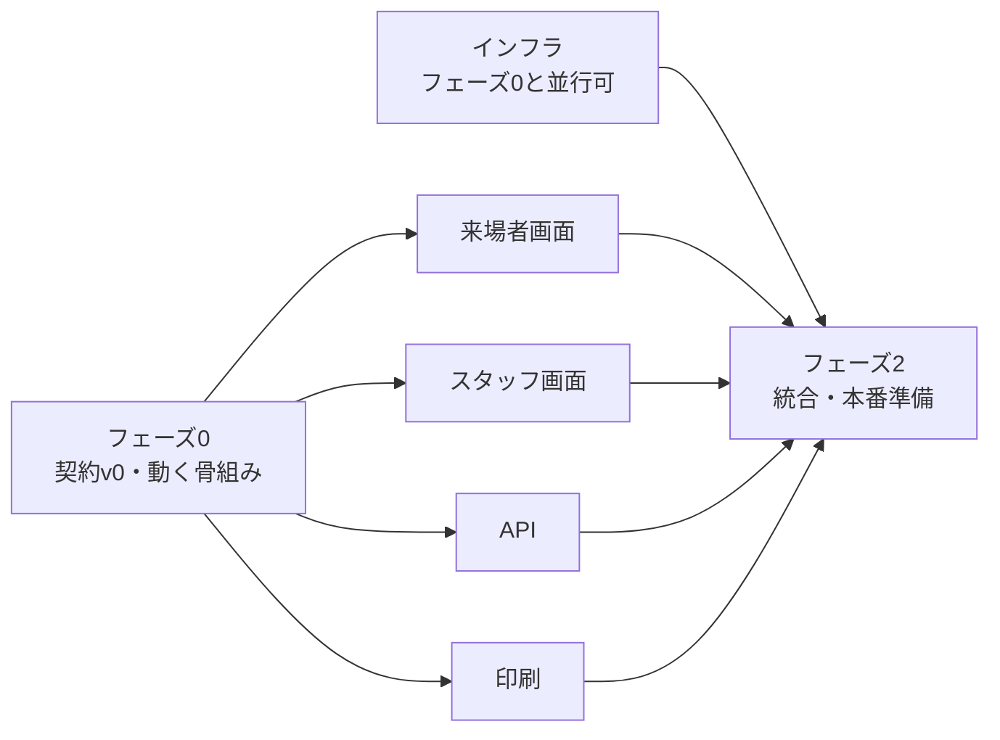

# 初期タスク一覧

仕様は [spec.md](spec.md) を参照。後半の「タスク解説」は Issue 本文の「背景」「やること」にそのまま転記できる。

## 進め方

フェーズ0を1〜2人で先に完成させ、その後フェーズ1の各タスクを参加者が選んで並行開発する。1行が1つのIssueに対応する。

インフラはコードへの依存がないため、フェーズ0と並行して着手できる。

| 列 | 意味 |
| --- | --- |
| ID | Issueのタイトル先頭に付ける番号 |
| 完了条件 | これを満たしたらPRをマージしてよい |
| 依存 | 先にマージされている必要があるタスク。「仮可」は仮実装の段階で着手してよいもの |
| 難易度 | 初級は `good first issue` ラベルの候補 |
| 実機 | ◎は実機での検証が必要なもの。ダミーでは問題が見つからないため早めに着手する |

### 優先度を下げたタスク

締切まで約1ヶ月のため、次は本筋が完成してから余裕があれば着手する。Issue には `優先度低` ラベルを付ける。

| 機能 | 対象タスク | 代わりの運用 |
| --- | --- | --- |
| アーカイブ一式 | W05、W06、W07、A04、S06 | なし（販売は成り立つ） |
| 回線断時の会場LAN運用 | I02 の PIN 認証部分、A05 の PIN 経路、Q03 | 回線が落ちたら紙で注文を受け、注文番号を手で振る手順を用意する |

## フェーズ0：基盤（契約v0・動く骨組み）

ここが終わるまでフェーズ1のアサインは開始しない。T09 の完了がフェーズ1開始の合図になる。

| ID | タスク | 完了条件 | 依存 | 難易度 | 実機 |
| --- | --- | --- | --- | --- | --- |
| T01 | モノレポ初期化 | apps/packages の雛形と `packages/config` を作成し、`bun install` と `bun run dev` で全appが起動する。turbo に dev/build/typecheck/lint/test を定義 | なし | 中級 | |
| T02 | CI構築 | PRごとに GitHub Actions で typecheck・lint・test が走り、失敗時はマージできない | T01 | 初級 | |
| T03 | リポジトリ運用ファイル | Issue・PRテンプレート、CODEOWNERS、CONTRIBUTING.md、README の骨子、ラベル、Projects ボードを用意 | T01 | 初級 | |
| T04 | 契約v0（packages/shared） | エンティティの zod スキーマ、ステータス列挙と遷移表、SSEイベント型、API のリクエスト・レスポンス型を定義 | T01 | 上級 | |
| T05 | DB（packages/db） | SQLite＋Drizzle のスキーマとマイグレーション、遷移表に基づく状態遷移関数、操作ログ記録を実装しテストを付ける | T04 | 上級 | |
| T06 | 共通サンプルデータ（packages/fixtures） | 全状態の注文・アーカイブ作品を含むサンプルデータと、SQLite へのシードスクリプト | T04, T05 | 中級 | |
| T07 | API骨組み（apps/api） | 契約v0の全エンドポイントが存在し、DBのシードデータを返す。SSE で最小限のイベントを配信 | T04〜T06 | 中級 | |
| T08 | バッジ仕様の仮値（packages/badge-spec） | 寸法・解像度・面付け数の型と仮の値を定義 | T01 | 初級 | |
| T09 | 動く骨組み（全体疎通） | 仮画面で、注文確定 → レジで番号入力して支払い済み → 開発用ドライバーでPDF出力 → 印刷確認 → 完成 → モニター表示、が一通り動く | T07, T08 | 上級 | |

## フェーズ1：来場者画面（web・editor）

| ID | タスク | 完了条件 | 依存 | 難易度 | 実機 |
| --- | --- | --- | --- | --- | --- |
| W01 | エディタ本体（packages/editor） | 画像アップロード、拡大・回転・位置調整、テキスト、背景色、塗り足し・安全領域のガイド表示。印刷解像度のPNGと編集データ（JSON）を出力 | T08 | 上級 | ◎ スマホでの操作性 |
| W02 | 注文フロー画面 | エディタの組み込み、個数指定、注文確定。確定後に注文状況ページへ遷移 | T09、W01（仮可） | 中級 | |
| W03 | 注文状況ページ | 注文QR・注文番号・確認コードを表示し、SSE で状態が自動更新される | T09 | 中級 | |
| W04 | 注文照会ページ | 注文番号＋確認コードで注文状況ページを開ける | T09 | 初級 | |
| W05 | アーカイブ閲覧 | 公開作品の一覧と詳細を表示 | T09 | 初級 | |
| W06 | アーカイブ投稿・取り下げ | 同意項目と表示名の入力で投稿でき、投稿した端末から取り下げられる | T09 | 中級 | |
| W07 | 作品からの注文 | 公開作品をコピーしたデザインで注文フローに入れる | W02, W05 | 中級 | |

## フェーズ1：スタッフ画面（staff・scanner）

| ID | タスク | 完了条件 | 依存 | 難易度 | 実機 |
| --- | --- | --- | --- | --- | --- |
| S01 | QR読み取り部品（packages/scanner） | カメラ常時起動でQRを自動検出、成功時に振動と音。カメラが使えない場合は検出不可を通知して非表示にできる | T01 | 中級 | ◎ iPhone・Android の両方 |
| S02 | レジ画面 | QR読み取りと番号入力を同じ入力で受け付け、確認画面（サムネイル・個数・金額・お釣り）から支払い済みにできる | T09、S01（仮可） | 中級 | |
| S03 | 印刷確認画面 | 印刷中のシートを表示し、OK・再印刷・一時停止・再開ができる | T09 | 中級 | |
| S04 | 組み立て・受け渡し画面 | 印刷済み注文の一覧から組み立て開始・完成を操作でき、受け渡し時に確認コードを照合できる。長時間未受け取りを強調表示 | T09 | 中級 | |
| S05 | 呼び出しモニター | `ready` の注文番号を大きく表示し、SSE で追加・削除される。サイトへの固定QRを表示 | T09 | 初級 | |
| S06 | アーカイブ審査画面 | 承認・却下・非公開化と、通報一覧の確認ができる | T09 | 初級 | |
| S07 | 設定・売上集計画面 | 受付の開始・停止、価格・上限の変更、時間帯別・支払い方法別の売上集計 | T09 | 中級 | |

## フェーズ1：API

画面側のタスクはシードデータを返すAPI骨組み（T07）の上で進められるため、APIの本番化を待たずに並行できる。

| ID | タスク | 完了条件 | 依存 | 難易度 | 実機 |
| --- | --- | --- | --- | --- | --- |
| A01 | 注文API | 注文作成、注文番号・確認コードの採番、支払い、状態遷移、受付終了時の自動失効が動き、テストがある | T09 | 上級 | |
| A02 | 画像の保存と配信 | アップロード画像の保存、容量・形式の制限、画像の配信 | T09 | 中級 | |
| A03 | SSE本番化 | 購読種別（注文・スタッフ・モニター）ごとの配信と、再接続時の全量再取得に対応 | T09 | 上級 | |
| A04 | アーカイブAPI | 投稿・審査・通報・取り下げ・作品からのコピー注文。元作品が非公開になったら支払い前の注文を止める | T09 | 中級 | |
| A05 | スタッフ認証 | Access 通過済み、または PIN 認証済みのリクエストのみスタッフ用APIを受け付ける | T09, I02 | 上級 | |
| A06 | 乱用対策 | 端末あたりの支払い待ち上限、Turnstile の検証、受付期間の制御 | A01 | 中級 | |

## フェーズ1：印刷（print-worker）

| ID | タスク | 完了条件 | 依存 | 難易度 | 実機 |
| --- | --- | --- | --- | --- | --- |
| P01 | 面付け・PDF生成 | badge-spec の値に従って複数バッジを用紙に配置し、各バッジ横に注文番号を印字したPDFを生成。較正用ページも生成できる | T08 | 中級 | |
| P02 | 印刷キュー制御 | 用紙1枚分または一定時間でまとめて印刷、同時印刷は1枚まで、一時停止・再開、再印刷時のキュー戻し | T09 | 上級 | |
| P03 | 本番印刷ドライバー | SumatraPDF を拡大縮小なしで呼び出して TS6730 で印刷し、較正ページで実寸が出ることを確認 | P01 | 中級 | ◎ Windows＋TS6730 |

## フェーズ1：インフラ

コードへの依存がないため、フェーズ0と並行して着手できる。大学への確認が必要な I03 は最優先。

| ID | タスク | 完了条件 | 依存 | 難易度 | 実機 |
| --- | --- | --- | --- | --- | --- |
| I01 | 処理PCの構築 | 専用ユーザーの自動ログオン、起動スクリプトによる全プロセス自動起動、Windows Update の停止、スリープ無効化を行い、手順を `infra/` に記録 | なし | 中級 | ◎ 処理PC |
| I02 | Caddy 設定 | ホスト名での振り分け、`/api` の転送、LAN経由時のPIN認証。SSE がバッファされずに届くことを確認 | なし | 中級 | ◎ |
| I03 | Cloudflare 設定 | 独自ドメイン、cloudflared のトンネル、Access、Turnstile、WAF・レート制限を設定し、学内ネットワークから疎通できることを確認 | 大学への確認 | 上級 | ◎ 学内ネットワーク |
| I04 | バックアップと復旧手順 | SQLite と画像の定期バックアップ、予備機での復旧手順書、復旧リハーサルの実施 | I01 | 中級 | ◎ |

## フェーズ2：統合・本番準備

| ID | タスク | 完了条件 | 依存 | 難易度 | 実機 |
| --- | --- | --- | --- | --- | --- |
| Q01 | 設定値の確定 | バッジマシン・用紙・価格などの未決事項を確定し、badge-spec と Setting に反映 | 仕様書15章の確認事項 | 初級 | ◎ バッジマシン |
| Q02 | 実機通しテスト | 本番環境（処理PC・プリンター・Cloudflare 経由）で、注文から受け渡しまでの全工程が動く | フェーズ1全体 | 中級 | ◎ |
| Q03 | 回線断テスト | 回線を切った状態で、LAN経由のレジ（番号入力）・印刷・呼び出しが継続できる | Q02 | 中級 | ◎ |
| Q04 | 運用リハーサル | スタッフ役を配置して模擬注文を流し、処理能力を測って受付上限と印刷待ち時間を調整する | Q02 | 初級 | ◎ |

---

# タスク解説

各タスクについて、なぜ必要か・何をするか・つまずきやすい点をまとめる。

## フェーズ0：基盤

### T01 モノレポ初期化

- **目的**：全員が同じ構成・同じコマンドで開発できる土台を作る
- **内容**：Bun のワークスペース設定、`turbo.json` のタスク定義、各 app が最小限起動する雛形、`packages/config` での tsconfig 共通化と lint・フォーマッターの選定
- **注意点**：Next.js を Bun ランタイムで動かすか Node ランタイムで動かすかを決めて README に明記する。本番は Windows なので、`.gitattributes` で改行コードを揃え、パス区切りに依存するコードを書かないルールにする

### T02 CI構築

- **目的**：契約を壊す変更を、マージ前に自動で検出する
- **内容**：GitHub Actions で Bun をセットアップし、`turbo run typecheck lint test` を実行。ブランチ保護で CI 成功をマージ条件にする
- **注意点**：Windows 実機でしか動かない印刷処理は CI の対象外にし、開発用ドライバーでテストする

### T03 リポジトリ運用ファイル

- **目的**：参加者の受け入れフローを回せる状態にする
- **内容**：Issue・PR テンプレート、CODEOWNERS（`packages/shared` を契約オーナーに割り当て）、CONTRIBUTING.md、ラベル、Projects ボード
- **注意点**：ルールは最小限にする。増やしすぎると初参加者が手を出しにくくなる

### T04 契約v0（packages/shared）

- **目的**：全 app が参照する唯一の定義を作る。以降の並行開発はすべてこれに依存する
- **内容**：エンティティの zod スキーマ、ステータス列挙と遷移表、SSE イベント型、API のリクエスト・レスポンス型
- **注意点**：遷移表はコードではなくデータとして定義し、db 側がそれを参照して検証する形にする。zod スキーマと Drizzle スキーマのどちらを正とするかを決め、二重管理を避ける。金額は円の整数で扱う。v0 で完璧を目指さず、変更は PR で行う前提にする

### T05 DB（packages/db）

- **目的**：状態変更の入口を1つにし、不正な遷移を防ぐ
- **内容**：bun:sqlite と Drizzle によるスキーマ・マイグレーション、状態遷移関数、操作ログの記録、それらのテスト
- **注意点**：api と print-worker の2プロセスが同じ SQLite を使うため、WAL モードとビジータイムアウトを設定する。状態の更新は「現在の状態」を条件に含めて行い、同時操作による二重遷移を防ぐ

### T06 共通サンプルデータ（packages/fixtures）

- **目的**：全員が同じダミーデータで開発し、ずれを防ぐ
- **内容**：全ステータスの注文、公開・審査中などのアーカイブ作品、サンプル画像、シードとリセットのスクリプト
- **注意点**：サンプル画像は自作か、利用条件が明確な素材だけを使う

### T07 API骨組み（apps/api）

- **目的**：画面側が最初から本物の API に向けて開発できるようにする
- **内容**：契約 v0 の全エンドポイントを Hono で定義し、シードデータを返す。SSE は最小限のイベント配信のみ
- **注意点**：仮実装でもレスポンスを zod スキーマで検証するテストを付け、契約とのずれを検出する

### T08 バッジ仕様の仮値（packages/badge-spec）

- **目的**：寸法値の置き場所を先に決め、エディタと印刷が同じ値を参照するようにする
- **内容**：直径・塗り足し・安全領域・解像度・面付けの型と仮の値、mm からピクセルへの換算関数
- **注意点**：値は mm で持ち、ピクセルへの換算は必ず関数を通す。各所で計算すると誤差の原因になる

### T09 動く骨組み（全体疎通）

- **目的**：最後にまとめて統合する工程をなくし、常に統合された状態で開発を進める
- **内容**：仮の画面で、注文確定から呼び出し表示までを一通りつなぐ。印刷は開発用ドライバーでフォルダに PDF を出力する
- **注意点**：見た目は作り込まない。完了した時点でフェーズ1のアサインを開始する

## 来場者画面（web・editor）

### W01 エディタ本体（packages/editor）

- **目的**：来場者がスマホだけでバッジのデザインを完成できるようにする。サービスの中心機能
- **内容**：Konva.js などのキャンバスライブラリで、画像の配置・拡大・回転、テキスト、背景色、塗り足しと安全領域のガイド表示を実装。確定時に印刷解像度の PNG と、再編集用の JSON を出力する
- **注意点**：タッチ操作（ピンチでの拡大・回転）を最初から前提にする。スマホの写真は解像度が高く、そのまま扱うとメモリ不足になりやすいので、読み込み時に上限サイズまで縮小する。フォントは端末によって差が出るため、Web フォントを読み込んでから描画する

### W02 注文フロー画面

- **目的**：デザインから注文確定までを一続きにする
- **内容**：エディタの組み込み、個数指定、注文内容の確認、確定。確定後は注文状況ページへ移動する
- **注意点**：エディタ（W01）が未完成でも、仮の画像アップロードだけで先に作れる。確定ボタンの二度押しで注文が重複しないようにする

### W03 注文状況ページ

- **目的**：来場者が自分の注文の進み具合を知り、レジと受け渡しで提示する画面
- **内容**：注文 QR を大きく、その下に注文番号と確認コード、現在の状態を表示。SSE で自動更新する
- **注意点**：レジでカメラに読ませるため、QR は画面幅いっぱい・余白付きで表示する。ページを開いたまま放置されても、再表示時に最新の状態を取り直す

### W04 注文照会ページ

- **目的**：Cookie が消えた人や端末を変えた人が、自分の注文を開けるようにする
- **内容**：注文番号と確認コードを入力すると注文状況ページを開ける
- **注意点**：総当たり防止のため、入力の試行回数を制限する

### W05 アーカイブ閲覧

- **目的**：公開作品を見て、注文のきっかけにしてもらう
- **内容**：公開作品の一覧（サムネイル・表示名）と詳細
- **注意点**：件数が増えても重くならないよう、一覧はサムネイル画像を使い、ページ送りか無限スクロールにする

### W06 アーカイブ投稿・取り下げ

- **目的**：来場者が作品を共有できるようにする
- **内容**：同意項目（自作であること・他の人の注文を認めること）へのチェックと表示名の入力で投稿。投稿した端末から取り下げ可能
- **注意点**：同意のチェックがないと投稿できないことを、画面と API の両方で保証する

### W07 作品からの注文

- **目的**：他の人の作品を元にバッジを注文できるようにする
- **内容**：公開作品のデザインをコピーして注文フローに入る
- **注意点**：コピー後に編集を許すかは未決事項。まずは編集なしで作り、決まったら拡張する

## スタッフ画面（staff・scanner）

### S01 QR読み取り部品（packages/scanner）

- **目的**：専用アプリなしで、スタッフのスマホを QR リーダーにする
- **内容**：`getUserMedia` で背面カメラを起動し続け、QR 解読ライブラリで自動検出する React 部品。成功時の振動・音、カメラが使えないときの通知
- **注意点**：カメラは HTTPS（または localhost）でしか使えない。スマホ画面に表示された QR は反射や明るさで読みにくいことがあるため、iPhone と Android の実機で早めに試す。同じ QR を連続で読んだときに二重処理しないよう、一定時間は同じ値を無視する

### S02 レジ画面

- **目的**：支払いを受けて注文を印刷待ちにする、ブースで最も混む工程
- **内容**：QR 読み取りと番号入力を1つの入力処理で受け付け、確認画面（サムネイル・個数・金額・受け取り額からのお釣り）を経て支払い済みにする
- **注意点**：操作は最小のタップ数にする。支払い済みにした直後に取り消せる手段（一定時間内の取り消し）を用意しておくと、押し間違いに対応できる

### S03 印刷確認画面

- **目的**：印刷の成否を人が確認して確定する
- **内容**：印刷中のシートとそこに載っている注文番号を表示し、OK・再印刷を操作。印刷の一時停止と再開
- **注意点**：用紙に印字された注文番号と画面の表示を照合しやすいよう、同じ並び順で表示する

### S04 組み立て・受け渡し画面

- **目的**：組み立ての進捗と受け渡しを管理する
- **内容**：印刷済み注文の一覧から組み立て開始・完成を操作。受け渡し時は番号で探し、確認コードを照合して受け渡し済みにする
- **注意点**：組み立て中は手がふさがるため、ボタンは大きく、誤タップしにくい配置にする。長時間受け取られていない注文を目立たせる

### S05 呼び出しモニター

- **目的**：完成した注文を来場者に知らせる
- **内容**：`ready` の注文番号を大きく一覧表示し、SSE で追加・削除する。サイトへの固定 QR を表示
- **注意点**：数メートル離れても読める文字サイズにする。処理PCの2画面目に全画面表示するので、スタッフ認証なしで localhost から開ける

### S06 アーカイブ審査画面

- **目的**：公開前に作品の権利面を確認する
- **内容**：審査待ちの作品の承認・却下、公開中作品の非公開化、通報一覧の確認
- **注意点**：判断に迷う作品のために「保留」にできると運用しやすい

### S07 設定・売上集計画面

- **目的**：当日の運用を責任者が画面から制御する
- **内容**：受付の開始・停止、価格・各種上限の変更、時間帯別・支払い方法別の売上集計
- **注意点**：売上集計はレジの現金と照合する用途なので、返金を差し引いた金額も表示する

## API

### A01 注文API

- **目的**：注文のライフサイクルを本番のロジックで動かす。システムの中核
- **内容**：注文作成、注文番号（日ごとの連番）と確認コードの採番、支払いの記録、状態遷移、受付終了時刻での自動失効
- **注意点**：注文番号の採番は同時注文でも重複しないよう、トランザクション内で行う。失効処理はプロセス再起動をまたいでも漏れないよう、「起動時と定期的に、期限切れの注文を探して失効させる」方式にする

### A02 画像の保存と配信

- **目的**：デザイン画像を安全に保存し、画面と印刷で使えるようにする
- **内容**：アップロード受付、容量・形式の検証、画像フォルダへの保存、配信（サムネイル含む）
- **注意点**：ファイル名は利用者の入力を使わずサーバー側で生成する。拡張子ではなくファイルの中身で形式を判定する

### A03 SSE本番化

- **目的**：状態の変化を画面に即時反映する
- **内容**：購読種別（特定の注文・スタッフ全体・呼び出しモニター）ごとの配信、定期的な接続維持用の送信、再接続時の全量再取得
- **注意点**：プロキシや Cloudflare 経由では、一定時間データが流れない接続が切られることがある。数十秒ごとに空のコメント行を送って接続を維持する

### A04 アーカイブAPI

- **目的**：投稿から公開・非公開までを管理する
- **内容**：投稿、審査（承認・却下）、通報、作者による取り下げ、作品のコピーによる注文
- **注意点**：元作品が非公開になったとき、そのコピーを含む支払い前の注文を止める処理を忘れない

### A05 スタッフ認証

- **目的**：スタッフ用APIを来場者から呼べないようにする
- **内容**：Cloudflare Access を通過したリクエスト、または Caddy で PIN 認証済みのリクエストだけを受け付ける
- **注意点**：Access 経由のリクエストに付くヘッダーは、Cloudflare を通らない経路では偽装できる。ヘッダーの有無だけでなく、Access が発行するトークンの署名を検証する。インフラ（I02・I03）の担当と一緒に進める

### A06 乱用対策

- **目的**：場所制限の代わりに、いたずらや大量注文を抑える
- **内容**：端末あたりの支払い待ち注文の上限、Turnstile のトークン検証、受付期間外の注文拒否
- **注意点**：Turnstile の検証はサーバー側で必ず行う。画面側の判定だけでは回避できる

## 印刷（print-worker）

### P01 面付け・PDF生成

- **目的**：複数のバッジを1枚の用紙に正確な寸法で並べる
- **内容**：badge-spec の値に従ってバッジ画像を用紙に配置し、各バッジの横に注文番号を印字した PDF を生成（pdf-lib 等）。定規目盛と基準円を載せた較正用ページも生成する
- **注意点**：PDF は mm（ポイント換算）で配置し、画像の解像度に関係なく実寸になるようにする。用紙端の印刷できない余白を避けて配置する

### P02 印刷キュー制御

- **目的**：用紙を無駄にせず、待ち時間も長くしすぎない
- **内容**：用紙1枚分がたまるか一定時間経過で印刷、同時に印刷中にできるのは1枚まで、一時停止・再開、再印刷時に明細をキューへ戻す
- **注意点**：処理PCが再起動しても、印刷中だったシートが二重に印刷されないよう、状態を DB に記録してから印刷を実行する

### P03 本番印刷ドライバー

- **目的**：Windows と TS6730 で実寸どおりに印刷する
- **内容**：SumatraPDF のコマンドラインを拡大縮小なしで呼び出す印刷ドライバー。開発用ドライバーと同じインターフェースで差し替える
- **注意点**：印刷品質や用紙種類は Windows の印刷設定の既定値で決まる。較正ページを印刷して定規で実測し、ずれを badge-spec の補正値に反映する。できるだけ早く実機で試す

## インフラ

### I01 処理PCの構築

- **目的**：電源を入れれば全サービスが自動で立ち上がる状態にする
- **内容**：専用ユーザーの自動ログオン、ログオン時にタスクスケジューラで全プロセスを起動するスクリプト、Windows Update の一時停止、スリープ・画面ロックの無効化、Bun・Caddy・cloudflared・SumatraPDF の導入
- **注意点**：手作業で設定した内容は必ず `infra/` に手順として残す。予備機で同じ状態を再現できることが目標

### I02 Caddy 設定

- **目的**：Cloudflare 経由と会場LAN経由の両方を1つの入口で受ける
- **内容**：ホスト名による web・staff の振り分け、`/api` の api への転送、LAN 経由のアクセスへの PIN 認証
- **注意点**：SSE がプロキシでため込まれず即時に届くかを確認する（必要なら該当パスのバッファリングを無効にする）。LAN 経由の判定方法を A05 の担当と合わせる

### I03 Cloudflare 設定

- **目的**：外部から安全にアクセスできるようにする
- **内容**：独自ドメインの取得と Cloudflare への登録、cloudflared のトンネル作成と Windows サービス化、staff ドメインへの Access 設定、Turnstile のサイト登録、WAF・レート制限のルール
- **注意点**：着手前に大学の学内ネットワーク利用規程を確認する。学内ネットワークから cloudflared の通信が通るかを早めに試し、通らない場合は大学側に相談する

### I04 バックアップと復旧手順

- **目的**：処理PCが故障しても学祭を続けられるようにする
- **内容**：SQLite と画像フォルダの定期バックアップ、予備機での復旧手順書、復旧リハーサル
- **注意点**：SQLite は書き込み中にファイルをコピーすると壊れることがある。SQLite のバックアップ機能（`VACUUM INTO` 等）で整合性のあるコピーを作る

## フェーズ2：統合・本番準備

### Q01 設定値の確定

- **目的**：仮の値を本番の値に置き換える
- **内容**：使用するバッジマシンのテンプレートから直径・塗り足しを決め、用紙・価格・各種上限を確定して badge-spec と Setting に反映
- **注意点**：寸法は、実際に印刷してバッジマシンでプレスし、仕上がりを見てから確定する

### Q02 実機通しテスト

- **目的**：本番と同じ環境で全工程が動くことを確かめる
- **内容**：処理PC・プリンター・Cloudflare 経由・実際のスマホで、注文から受け渡しまでを通す
- **注意点**：開発時と違い、ここで初めて組み合わさるもの（本番ドメイン、Access、実機カメラ、実プリンター）の問題が出やすい。本番の数週間前には実施する

### Q03 回線断テスト

- **目的**：インターネットが切れても学祭の運営を止めない
- **内容**：処理PCのインターネット接続を切り、LAN 経由でのレジ（番号入力）・印刷・呼び出しが続けられることを確認。代理入力の手順も試す
- **注意点**：スタッフ端末がモバイル回線に切り替わると会場 LAN に届かない。LAN 経由で使うときの端末の接続手順も確認する

### Q04 運用リハーサル

- **目的**：当日の処理能力を把握し、設定値と人員配置を決める
- **内容**：スタッフ役を配置し、模擬注文を流して、1時間あたりに処理できる件数を測る。結果から受付上限と印刷待ち時間を調整
- **注意点**：ボトルネックは多くの場合、システムではなく手作業の組み立てになる。組み立ての人数と、受付を止める判断基準をここで決める
