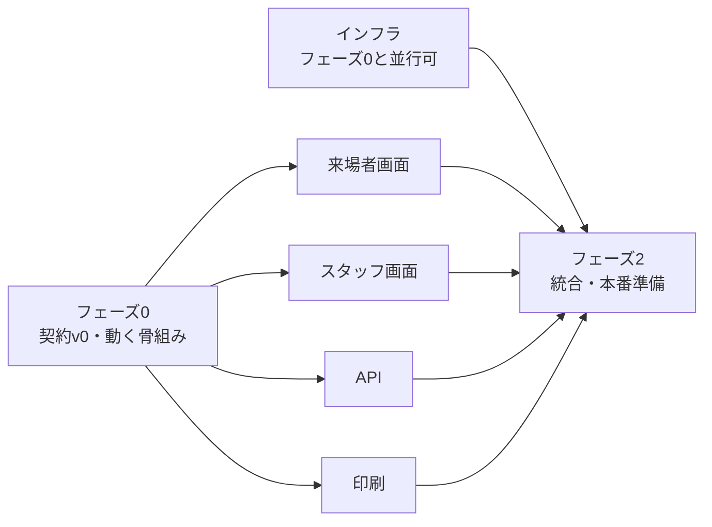
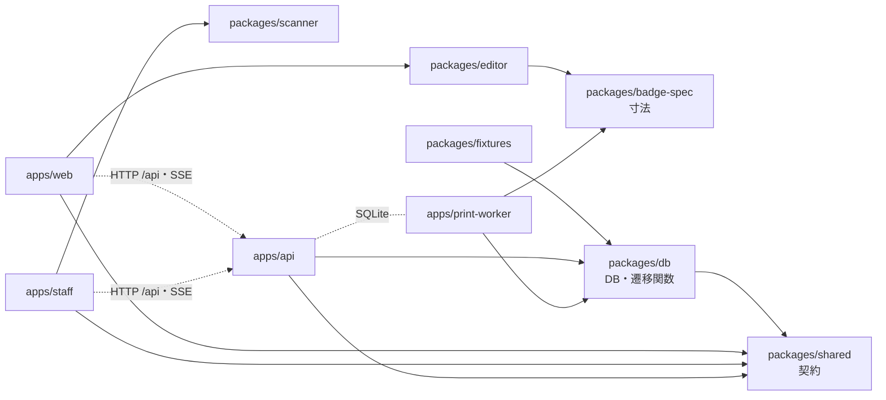

# 初期タスク一覧

仕様は [spec.md](spec.md) を参照。後半の「タスク解説」は Issue 本文の「背景」「やること」にそのまま転記できる。

## 進め方

フェーズ0を1〜2人で先に完成させ、その後フェーズ1の各タスクを参加者が選んで並行開発する。1行が1つのIssueに対応する。



インフラはコードへの依存がないため、フェーズ0と並行して着手できる。

| 列 | 意味 |
| --- | --- |
| ID | Issueのタイトル先頭に付ける番号 |
| 完了条件 | これを満たしたらPRをマージしてよい |
| 依存 | 先にマージされている必要があるタスク。「仮可」は仮実装の段階で着手してよいもの |
| 難易度 | 初級は `good first issue` ラベルの候補 |
| 実機 | ◎は実機での検証が必要なもの。ダミーでは問題が見つからないため早めに着手する |

### 優先度を下げたタスク

締切まで約1ヶ月のため、次は本筋が完成してから余裕があれば着手する。Issue には `優先度低` ラベルを付ける。

| 機能 | 対象タスク | 代わりの運用 |
| --- | --- | --- |
| アーカイブ一式 | W05、W06、W07、A04、S06 | なし（販売は成り立つ） |
| 回線断時の会場LAN運用 | I02 の PIN 認証部分、A05 の PIN 経路、Q03 | 回線が落ちたら紙で注文を受け、注文番号を手で振る手順を用意する |

## フェーズ0：基盤（契約v0・動く骨組み）

ここが終わるまでフェーズ1のアサインは開始しない。T09・T10 の完了がフェーズ1開始の合図になる。

| ID | タスク | 完了条件 | 依存 | 難易度 | 実機 |
| --- | --- | --- | --- | --- | --- |
| T01 | モノレポ初期化 | apps/packages の雛形と `packages/config` を作成し、`bun install` と `bun run dev` で全appが起動する。turbo に dev/build/typecheck/lint/test を定義 | なし | 中級 | |
| T02 | CI構築 | PRごとに GitHub Actions で typecheck・lint・test が走り、失敗時はマージできない | T01 | 初級 | |
| T03 | リポジトリ運用ファイル | Issue・PRテンプレート、CODEOWNERS、CONTRIBUTING.md、README の骨子、ラベル、Projects ボードを用意 | T01 | 初級 | |
| T04 | 契約v0（packages/shared） | エンティティの zod スキーマ、ステータス列挙と遷移表、SSEイベント型、API のリクエスト・レスポンス型を定義 | T01 | 上級 | |
| T05 | DB（packages/db） | SQLite＋Drizzle のスキーマとマイグレーション、遷移表に基づく状態遷移関数、操作ログ記録を実装しテストを付ける | T04 | 上級 | |
| T06 | 共通サンプルデータ（packages/fixtures） | 全状態の注文・アーカイブ作品を含むサンプルデータと、SQLite へのシードスクリプト | T04, T05 | 中級 | |
| T07 | API骨組み（apps/api） | 契約v0の全エンドポイントが存在し、DBのシードデータを返す。SSE で最小限のイベントを配信 | T04〜T06 | 中級 | |
| T08 | バッジ仕様の仮値（packages/badge-spec） | 寸法・解像度・面付け数の型と仮の値を定義 | T01 | 初級 | |
| T09 | 動く骨組み（全体疎通） | 仮画面で、注文確定 → レジで番号入力して支払い済み → 開発用ドライバーでPDF出力 → 印刷確認 → 完成 → モニター表示、が一通り動く | T07, T08 | 上級 | |
| T10 | デザインの土台（design.md・packages/ui） | Hallmark で共通のデザインを `design.md` に固定し、`packages/ui` にデザイントークン（CSS 変数）と最小限の共通部品を用意する。web と staff の仮画面がそのトークンを使っている | T01 | 中級 | |

## フェーズ1：来場者画面（web・editor）

| ID | タスク | 完了条件 | 依存 | 難易度 | 実機 |
| --- | --- | --- | --- | --- | --- |
| W01 | エディタ本体（packages/editor） | 画像アップロード、拡大・回転・位置調整、テキスト、スタンプ、背景色、簡単なお絵描き（ペン）、写真のフィルター、塗り足し・安全領域のガイド表示。印刷解像度のPNGと編集データ（JSON）を出力 | T08 | 上級 | ◎ スマホでの操作性 |
| W02 | 注文フロー画面 | エディタの組み込み、個数指定、注文確定。確定後に注文状況ページへ遷移 | T09、W01（仮可） | 中級 | |
| W03 | 注文状況ページ | 注文QR・注文番号・確認コードを表示し、SSE で状態が自動更新される | T09 | 中級 | |
| W04 | 注文照会ページ | 注文番号＋確認コードで注文状況ページを開ける | T09 | 初級 | |
| W05 | アーカイブ閲覧 | 公開作品の一覧と詳細を表示 | T09 | 初級 | |
| W06 | アーカイブ投稿・取り下げ | 同意項目と表示名の入力で投稿でき、投稿した端末から取り下げられる | T09 | 中級 | |
| W07 | 作品からの注文 | 公開作品をコピーしたデザインで注文フローに入れる | W02, W05 | 中級 | |
| W08 | Discord アイコンの取り込み | エディタのボタンから Discord の許可を経て、アイコンがエディタに画像として読み込まれる。Discord の ID・トークンを保存しない。拒否・失敗時はエディタに戻ってエラーを表示する | W02、A02（仮可） | 中級 | |

## フェーズ1：スタッフ画面（staff・scanner）

| ID | タスク | 完了条件 | 依存 | 難易度 | 実機 |
| --- | --- | --- | --- | --- | --- |
| S01 | QR読み取り部品（packages/scanner） | カメラ常時起動でQRを自動検出、成功時に振動と音。カメラが使えない場合は検出不可を通知して非表示にできる | T01 | 中級 | ◎ iPhone・Android の両方 |
| S02 | レジ画面 | QR読み取りと番号入力を同じ入力で受け付け、確認画面（サムネイル・個数・金額・お釣り）から支払い済みにできる | T09、S01（仮可） | 中級 | |
| S03 | 印刷確認画面 | 印刷中のシートをバッジごとに OK・再印刷で確認でき、一時停止・再開ができる。印刷済みのバッジと印刷ジョブの履歴をサムネイル付きで見られ、そこから選んで再印刷できる | T09 | 中級 | |
| S04 | 組み立て・受け渡し画面 | 印刷済み注文の一覧から組み立て開始・完成を操作でき、受け渡し時に確認コードを照合できる。長時間未受け取りを強調表示 | T09 | 中級 | |
| S05 | 呼び出しモニター | `ready` の注文番号を大きく表示し、SSE で追加・削除される。サイトへの固定QRを表示 | T09 | 初級 | |
| S06 | アーカイブ審査画面 | 承認・却下・非公開化と、通報一覧の確認ができる | T09 | 初級 | |
| S07 | 設定・売上集計画面 | 営業開始・ビジー・受付終了の操作、価格・上限の変更、時間帯別の売上集計 | T09 | 中級 | |

## フェーズ1：API

画面側のタスクはシードデータを返すAPI骨組み（T07）の上で進められるため、APIの本番化を待たずに並行できる。

| ID | タスク | 完了条件 | 依存 | 難易度 | 実機 |
| --- | --- | --- | --- | --- | --- |
| A01 | 注文API | 注文作成、注文番号・確認コードの採番、支払い、状態遷移、営業開始・受付状態の切り替えと受付終了時の失効が動き、テストがある | T09 | 上級 | |
| A02 | 画像の保存と配信 | アップロード画像の保存、容量・形式の制限、画像の配信 | T09 | 中級 | |
| A03 | SSE本番化 | 購読種別（注文・スタッフ・モニター）ごとの配信と、再接続時の全量再取得に対応 | T09 | 上級 | |
| A04 | アーカイブAPI | 投稿・審査・通報・取り下げ・作品からのコピー注文。元作品が非公開になったら支払い前の注文を止める | T09 | 中級 | |
| A05 | スタッフ認証 | Access 通過済み、または PIN 認証済みのリクエストのみスタッフ用APIを受け付ける | T09, I02 | 上級 | |
| A06 | 乱用対策 | 端末あたりの支払い待ち上限、Turnstile の検証、受付状態（busy・closed）での注文拒否 | A01 | 中級 | |

## フェーズ1：印刷（print-worker）

| ID | タスク | 完了条件 | 依存 | 難易度 | 実機 |
| --- | --- | --- | --- | --- | --- |
| P01 | 面付け・PDF生成 | badge-spec の値に従って複数バッジを用紙に配置し、各バッジ横に注文番号を印字したPDFを生成。較正用ページも生成できる | T08 | 中級 | |
| P02 | 印刷キュー制御 | 用紙1枚分または一定時間でまとめて印刷、同時印刷は1枚まで、一時停止・再開、再印刷のバッジを優先して次のシートに載せる | T09 | 上級 | |
| P03 | 本番印刷ドライバー | SumatraPDF を拡大縮小なしで呼び出して TS6730 で印刷し、較正ページで実寸が出ることを確認 | P01 | 中級 | ◎ Windows＋TS6730 |

## フェーズ1：インフラ

コードへの依存がないため、フェーズ0と並行して着手できる。大学への確認が必要な I03 は最優先。

| ID | タスク | 完了条件 | 依存 | 難易度 | 実機 |
| --- | --- | --- | --- | --- | --- |
| I01 | 処理PCの構築 | 専用ユーザーの自動ログオン、起動スクリプトによる全プロセス自動起動、Windows Update の停止、スリープ無効化を行い、手順を `infra/` に記録 | なし | 中級 | ◎ 処理PC |
| I02 | Caddy 設定 | ホスト名での振り分け、`/api` の転送、LAN経由時のPIN認証。SSE がバッファされずに届くことを確認 | なし | 中級 | ◎ |
| I03 | Cloudflare 設定 | 独自ドメイン、cloudflared のトンネル、Access、Turnstile、WAF・レート制限を設定し、学内ネットワークから疎通できることを確認 | 大学への確認 | 上級 | ◎ 学内ネットワーク |
| I04 | バックアップと復旧手順 | SQLite と画像の定期バックアップ、予備機での復旧手順書、復旧リハーサルの実施 | I01 | 中級 | ◎ |

## フェーズ2：統合・本番準備

| ID | タスク | 完了条件 | 依存 | 難易度 | 実機 |
| --- | --- | --- | --- | --- | --- |
| Q01 | 設定値の確定 | バッジマシン・用紙・価格などの未決事項を確定し、badge-spec と Setting に反映 | 仕様書15章の確認事項 | 初級 | ◎ バッジマシン |
| Q02 | 実機通しテスト | 本番環境（処理PC・プリンター・Cloudflare 経由）で、注文から受け渡しまでの全工程が動く | フェーズ1全体 | 中級 | ◎ |
| Q03 | 回線断テスト | 回線を切った状態で、LAN経由のレジ（番号入力）・印刷・呼び出しが継続できる | Q02 | 中級 | ◎ |
| Q04 | 運用リハーサル | スタッフ役を配置して模擬注文を流し、処理能力を測って受付上限と印刷待ち時間を調整する | Q02 | 初級 | ◎ |

---

# タスク解説

各タスクについて、なぜ必要か・何をするか・つまずきやすい点をまとめる。各タスクの「つながり」には、使うもの・提供するもの・受け渡す値を書いている。

## 全体のつながり（先に読む）

各タスクの「つながり」は、この章の名前を使って書いている。

> [!IMPORTANT]
> 型・API・SSE・エラーの形は、**T04 で `packages/shared/src` に実装済み**（契約v0）。確定した定義は常にコードが正で、この章は読み物として、食い違ったらコードに合わせて直す。エンドポイントの一覧と入出力は `packages/shared/src/api/endpoints.ts`。

### パッケージの依存関係

矢印は「import する」向き。app 同士は import せず、web・staff は HTTP（`/api`）と SSE だけで api とやり取りする。api と print-worker は互いを呼ばず、同じ SQLite を介して連携する。



### データの置き場所

| もの | 置き場所 | 備考 |
| --- | --- | --- |
| DB | `data/app.db`（SQLite） | api と print-worker が共有。WAL モード |
| デザイン画像 | `data/images/` | DB にはパスだけを持つ。ファイル名はサーバーが生成 |
| 生成した PDF | `data/sheets/` | 開発用ドライバーの出力先も兼ねる |
| 設定値 | DB の `Setting`（1行だけのテーブル） | 営業日・受付状態・価格・上限・印刷の一時停止など、当日変える値 |
| 寸法 | `packages/badge-spec` のコード | 当日は変えない値 |

`data/` はコミット対象外。場所は環境変数（例: `DATA_DIR`）で変えられるようにし、パスは `node:path` で組み立てる。

### 主なデータの形（叩き台）

金額はすべて円の整数。日時は ISO 8601 文字列。

**型の正本は zod（決定）。** `packages/shared` の zod スキーマが唯一の定義で、TypeScript の型は `z.infer` で導出する。Drizzle のテーブル定義（`packages/db`）はそれに合わせて書き、ずれは型レベルのテストで検出する。下の `type` は読みやすさのための表記で、実際は zod スキーマとして書く。

#### 決定済みの前提

| 項目 | 決定 |
| --- | --- |
| 1注文の中身 | デザイン1つ・缶バッジ1個が原則。エディタはプリクラ風（写真にスタンプ・フレーム・文字・簡単なお絵描き・フィルター）。個数の上限は `Setting.maxQuantityPerOrder`（既定 1）で、1 のとき画面は個数の選択を出さない |
| 支払い方法 | 現金のみ。支払い方法の項目は持たない |
| 返金 | 全額返金のみ。返金額は `totalAmount` と同じ。支払い後のどの状態からでもできる（受け渡し済みを含む） |
| 来場者の取り消し | 支払い前（`submitted`）のみ |
| 実行者（actor） | `"staff"`・`"visitor"`・`"system"` の3種類。スタッフは個人を区別しない |
| 注文QRの中身 | `orderId` の文字列だけ |
| 確認コード | 紛らわしい文字（`0` `O` `1` `I` `L`）を除いた英大文字・数字 4 文字。入力時は小文字も受け付ける |
| 営業日 | スタッフ画面（S07）の「営業開始」で決まる。注文番号は営業日ごとに 1 から |
| 受付状態 | `open`（受付中）・`busy`（混雑で一時停止）・`closed`（受付終了）。スタッフ画面で切り替える |
| 使われなかった画像 | アップロードから 15 分たっても注文に使われなければ削除 |
| print-worker の変更の伝え方 | api が数秒ごとに DB を確認して SSE を流す（下の NOTE） |
| ステータスの表示名 | shared に置く（例: `orderStatusLabels`） |

```ts
// ステータス（spec.md 8章・11章）
type OrderStatus = "submitted" | "paid" | "printed" | "assembling" | "ready"
  | "picked_up" | "expired" | "cancelled" | "refunded";
type OrderItemStatus = "queued" | "printing" | "printed";
type PrintSheetStatus = "printing" | "confirmed" | "failed";
type ArchiveStatus = "pending_review" | "public" | "rejected" | "hidden";
type Actor = "staff" | "visitor" | "system";
type Acceptance = "open" | "busy" | "closed";

type Design = {
  id: string;
  imagePath: string;          // data/images からの相対パス
  editorData: unknown;        // エディタの編集データ（JSON）。中身は editor が決め、version を持たせる
  sourceArchiveEntryId?: string;
  createdAt: string;
};

type Order = {
  id: string;                 // ULID。注文QRの中身・注文状況ページの URL
  businessDate: string;       // 営業開始で決まった日付 "2026-11-03"。注文番号はこの日付の中で一意
  orderNumber: number;        // 表示時に桁数（Setting）でゼロ埋め
  confirmationCode: string;   // 例: "K7QH"
  anonToken: string;          // 来場者の Cookie の値。画面には返さない
  status: OrderStatus;
  totalAmount: number;        // 価格 × 個数
  createdAt: string;
  paidAt?: string; readyAt?: string; pickedUpAt?: string; refundedAt?: string;
  // 明細（OrderItem）は別の行。画面向けの形（明細つき）は api/ の OrderView・StaffOrderView
};

type OrderItem = {
  id: string; orderId: string; designId: string;
  quantity: number;           // 原則 1
  status: OrderItemStatus;
  printCount: number;         // 印刷された回数。1 以上で queued なら再印刷待ち（優先して次のシートへ）
};

type PrintSheet = {
  id: string; pdfPath: string; status: PrintSheetStatus; printedAt: string; checkedAt?: string;
};

// シート上のバッジ1個 = 1行。印刷の履歴はこの表に全部残る
type PrintSlot = {
  sheetId: string;
  position: number;           // PDF 上の並び順
  orderItemId: string;
  result: "pending" | "ok" | "reprint";  // 印刷確認の結果
};

// 1行だけのテーブル（id = 1 固定）
type Setting = {
  businessDate: string | null;    // 営業開始で設定
  acceptance: Acceptance;
  busyMessage: string | null;     // busy のとき来場者に見せる文言
  price: number;                  // 1個あたり
  maxQuantityPerOrder: number;    // 既定 1。面付け数を超えないこと
  maxPendingPerDevice: number;    // 端末あたりの支払い待ち上限
  printMaxWaitSeconds: number;    // 用紙1枚分たまらなくても印刷するまでの時間
  printPaused: boolean;
  orderNumberDigits: number;
  imageMaxBytes: number;
  updatedAt: string;
};

type AuditLog = { id: string; actor: Actor; at: string; action: string; targetType: string; targetId: string; detail?: unknown };
```

遷移表はデータで持つ（`packages/shared/CLAUDE.md`）。

```ts
const orderTransitions = [
  { from: "submitted", to: "paid",      actors: ["staff"] },
  { from: "submitted", to: "expired",   actors: ["system"] },            // 受付終了・営業開始の操作で
  { from: "submitted", to: "cancelled", actors: ["visitor", "staff"] },
  { from: "paid",      to: "printed",   actors: ["system"] },            // 全明細が printed になったら
  { from: "printed",   to: "assembling", actors: ["staff"] },
  { from: "assembling", to: "ready",    actors: ["staff"] },
  { from: "ready",     to: "picked_up", actors: ["staff"] },
  { from: "printed",   to: "paid",      actors: ["staff"] },             // 再印刷（下の「印刷の確認・履歴・再印刷」）
  { from: "assembling", to: "paid",     actors: ["staff"] },             // 再印刷
  { from: "ready",     to: "paid",      actors: ["staff"] },             // 再印刷
  // refunded は paid 以降のどの状態からも staff が実行できる（全額返金）
] as const;

const orderItemTransitions = [
  { from: "queued",   to: "printing", actors: ["system"] },  // print-worker がシートに載せた
  { from: "printing", to: "printed",  actors: ["staff"] },   // 印刷確認で OK
  { from: "printing", to: "queued",   actors: ["staff"] },   // 印刷確認で再印刷
  { from: "printed",  to: "queued",   actors: ["staff"] },   // 履歴から再印刷
] as const;
```

#### 営業日と受付状態の操作

スタッフ画面（S07）から次の操作をする。受付時刻による自動の失効は行わない。

| 操作 | やること |
| --- | --- |
| 営業開始 | `businessDate` を今日（日本時間）にし、`acceptance` を `open` にする。前の営業日に残った `submitted` を `expired` にする |
| ビジー | `acceptance` を `busy` にし、`busyMessage` を設定する。新規注文だけを断り、支払い・印刷・受け渡しは続く |
| ビジー解除 | `acceptance` を `open` に戻す |
| 受付終了 | `acceptance` を `closed` にし、当日の `submitted` を `expired` にする |

`busy` と `closed` の間も、デザインの作成と注文状況の確認はできる。web は `GET /api/status` を見て、注文ボタンの代わりに「混雑のため受付を一時停止しています」などを表示する。

#### エラーの形

成功時はデータをそのまま返し、失敗時は HTTP ステータスと次の形の本体を返す。`code` は shared の列挙、`message` は画面にそのまま出せる日本語にする。

```ts
type ApiError = { error: { code: ErrorCode; message: string; details?: unknown } };
```

| `code` | HTTP | 使う場面 |
| --- | --- | --- |
| `VALIDATION_FAILED` | 400 | zod の検証に失敗。`details` に項目ごとのエラー |
| `UNAUTHORIZED` | 401 | スタッフ認証がない |
| `NOT_FOUND` | 404 | 注文などが見つからない。照会の失敗もこれにして、番号とコードのどちらが違うかは教えない |
| `INVALID_TRANSITION` | 409 | 遷移表にない操作（例: 支払い済みの注文をもう一度支払う） |
| `CONFLICT` | 409 | 同時操作で先に状態が変わった |
| `CONFIRMATION_MISMATCH` | 409 | 受け渡し時の確認コードが違う |
| `PAYLOAD_TOO_LARGE` | 413 | 画像が大きすぎる |
| `UNSUPPORTED_MEDIA_TYPE` | 415 | 画像の形式が対象外 |
| `RATE_LIMITED` | 429 | 照会の試行回数・支払い待ちの上限を超えた |
| `NOT_ACCEPTING` | 503 | 受付が `busy` か `closed`。`details` に `{ acceptance, busyMessage }` |
| `INTERNAL` | 500 | 想定外のエラー。詳細はログにだけ出す |

### API の叩き台

ブラウザからは常に同一オリジンの `/api` を呼ぶ。スタッフ用は `/api/staff/*` にまとめ、A05 のミドルウェアで一括して守る。

| 用途 | メソッドとパス | 主な入出力 | 使う画面 |
| --- | --- | --- | --- |
| 受付状況 | `GET /api/status` | `{ acceptance, busyMessage, price, maxQuantityPerOrder, waitingCount }` | web |
| 画像アップロード | `POST /api/images` | multipart → `{ imageId }`。15 分以内に注文に使われなければ削除 | web（W02） |
| 注文作成 | `POST /api/orders` | `{ imageId, editorData, quantity, turnstileToken, rightsConsent: true }` → `{ orderId }`。受付外は `NOT_ACCEPTING`。持ち込み画像の権利確認への同意が必須 | web（W02） |
| 注文取得 | `GET /api/orders/:orderId` | 注文状況ページ用の表示データ | web（W03） |
| 注文照会 | `POST /api/orders/lookup` | `{ orderNumber, confirmationCode }` → `{ orderId }` | web（W04） |
| 注文の取り消し | `POST /api/orders/:orderId/cancel` | — | web |
| 注文の検索 | `GET /api/staff/orders?q=&status=` | QR の中身か注文番号 → 注文 | staff（S02・S04） |
| 支払い | `POST /api/staff/orders/:orderId/pay` | 本体なし（現金のみ。お釣りは画面で計算） | staff（S02） |
| 組み立て・完成・受け渡し・返金 | `POST /api/staff/orders/:orderId/{assemble,complete,pickup,refund}` | pickup は `{ confirmationCode }`。refund は全額 | staff（S04・S07） |
| 注文の取り消し（スタッフ） | `POST /api/staff/orders/:orderId/cancel` | 支払い前の注文 | staff |
| 印刷中のシート | `GET /api/staff/print-sheets/current` | `{ sheet }`（印刷中がなければ null）。バッジは位置・注文番号・サムネイル付き | staff（S03） |
| 印刷の確認 | `POST /api/staff/print-sheets/:sheetId/check` | `{ reprintOrderItemIds }`。空なら全部 OK | staff（S03） |
| 印刷ジョブの履歴 | `GET /api/staff/print-sheets?before=&limit=` | 新しい順のシートと、載ったバッジ（サムネイル・注文番号・確認結果） | staff（S03） |
| シートのプレビュー | `GET /api/staff/print-sheets/:sheetId/pdf` | 印刷した PDF | staff（S03） |
| 印刷済みバッジの一覧 | `GET /api/staff/printed-items?q=&before=&limit=` | バッジごとのサムネイル・注文番号・注文の状態・印刷回数。`q` は注文番号 | staff（S03） |
| 再印刷 | `POST /api/staff/reprints` | `{ orderItemIds }` → `{ reprintedItemIds, skippedItemIds }`。バッジ一覧からもシートからも同じ API。再印刷できないバッジが 1 つでもあれば全体を `INVALID_TRANSITION` で断る | staff（S03） |
| 印刷の一時停止・再開 | `POST /api/staff/print-queue/{pause,resume}` | `Setting.printPaused` を更新 | staff（S03） |
| 営業日 | `POST /api/staff/business-day/open` | 営業開始 | staff（S07） |
| 受付状態 | `POST /api/staff/acceptance` | `{ acceptance: "open" \| "busy" \| "closed", busyMessage? }` | staff（S07） |
| 設定 | `GET/PUT /api/staff/settings` | `Setting`（営業日・受付状態・一時停止は上の専用 API で変える） | staff（S07） |
| 売上集計 | `GET /api/staff/sales?businessDate=` | 時間帯別の件数と金額、返金を引いた合計 | staff（S07） |
| 呼び出し一覧 | `GET /api/monitor/ready` | `ready` の注文番号一覧。注文 ID（QR の中身）は含めない | staff（S05） |
| 画像の配信 | `GET /api/images/:imageId`（`?size=thumb`） | 画像 | web・staff |
| 作品の一覧・詳細 | `GET /api/archive`・`GET /api/archive/:entryId` | 公開中の作品（サムネイル・表示名。詳細は大きい画像と `editorData`）。作者本人は、自分の作品なら、どの状態でも | web（W05） |
| 自分の投稿 | `GET /api/my/archive` | 自分が投稿した作品と状態 | web（W06） |
| 投稿・取り下げ・通報 | `POST /api/archive`・`POST /api/archive/:entryId/{withdraw,report}` | 投稿は `{ imageId, editorData, displayName, consent }`（同意 2 項目が true でなければ 400）。取り下げは作者だけ | web（W06） |
| 作品からの注文 | `POST /api/archive/:entryId/order` | `{ quantity, turnstileToken, rightsConsent }` → `{ orderId }`。通常の注文と同じ処理。元作品が非公開になったら、支払い前の注文は止まる | web（W07） |
| アーカイブの審査 | `GET /api/staff/archive`・`POST /api/staff/archive/:entryId/{approve,reject,hide}` | 状態で絞る一覧（未対応の通報の件数つき）・承認・却下・非公開 | staff（S06） |
| 通報の対応 | `GET /api/staff/archive/reports`・`POST /api/staff/archive/reports/:reportId/resolve` | 通報の一覧（作品の概要つき）・対応済み | staff（S06） |
| Discord アイコンの取り込み開始 | `GET /api/discord/authorize` | Discord の許可画面へリダイレクト（`state` を Cookie に保存） | web（W08） |
| Discord からの戻り | `GET /api/discord/callback?code=&state=` | アイコンを取得して保存し、`/<エディタのパス>?imageId=` へリダイレクト。失敗時は `?discordError=<code>` | web（W08） |
| SSE | `GET /api/events/orders/:orderId`、`/api/staff/events`、`/api/monitor/events` | 下記イベント | web・staff |

### SSE イベントの叩き台

SSE は「変わった」ことだけを知らせ、受け取った画面は REST で取り直す（spec.md 10章）。判別可能なユニオン型にする。

```ts
type SseEvent =
  | { type: "order.updated"; orderId: string; status: OrderStatus }
  | { type: "queue.updated" }                               // 印刷待ちの件数が変わった
  | { type: "sheet.updated"; sheetId: string; status: PrintSheetStatus }
  | { type: "monitor.updated" }                             // ready 一覧が変わった
  | { type: "settings.updated" };
```

> [!NOTE]
> print-worker が DB を変えたことは、**api が数秒ごとに DB を確認して** 知る（決定）。遷移関数は actor が `system` の遷移も含めてすべて AuditLog に記録するので、api は「前回確認した以降の AuditLog」を読み、対応する SSE イベントを流せばよい。api 自身の操作も同じ仕組みに乗せると、イベントを流す場所が1か所で済む。

#### 印刷の確認・履歴・再印刷

1枚の用紙には複数の注文のバッジが載る。

**印刷直後の確認**：印刷係は用紙を見て、バッジごとに OK か再印刷を選んで確定する（`check`）。

- 確認が済んだシートは `confirmed`。OK のバッジは `printed`、再印刷のバッジは `queued` に戻る
- 紙詰まりなどで全部を再印刷に回したときだけ、シートを `failed` にする

**履歴からの再印刷**：組み立て中に傷が見つかった場合などのため、これまでに印刷したバッジとシートを全部、サムネイル付きで見られるようにする。再印刷は次のどちらからでもでき、どちらも `POST /api/staff/reprints` を呼ぶ。

- 印刷済みバッジの一覧（注文番号で検索）から、バッジを選ぶ
- 直近の印刷ジョブ（シート）を開き、そこに載ったバッジを選ぶ（全部選べばシートごと再印刷）

再印刷したときの状態の更新（1つのトランザクションで行う）：

| 対象 | 再印刷前 | 再印刷後 |
| --- | --- | --- |
| バッジ（明細） | `printed` | `queued`。`printCount` が 1 以上なので、次のシートの先頭に優先して載る |
| 注文 | `printed`・`assembling`・`ready` | `paid`（印刷待ち）に戻る。再印刷分の確認が OK になると自動で `printed` に進む |
| 注文 | `paid` | そのまま |
| 呼び出しモニター | `ready` だった注文 | 一覧から消える（`monitor.updated`） |

- `queued` のバッジ（すでに再印刷待ち）は何もしない。`printing` のバッジ（確認前のシートに載っている）は、履歴からではなく `check` で再印刷を選ぶ（`INVALID_TRANSITION`）
- 注文が `picked_up`・`cancelled`・`expired`・`refunded` のバッジは再印刷できない（`INVALID_TRANSITION`）
- 操作ログには `action: "reprint"` と、再印刷前の状態を残す

### UI の方針（画面を作る全タスク共通）

見た目は Hallmark（anti-AI-slop のデザインスキル）のルールに従う（spec.md 6.4）。

- 共通のデザイン（配色・書体・余白など）はプロジェクト直下の `design.md` に固定し、`packages/ui` のデザイントークン（CSS 変数）として実装する。画面側で色や書体を直接書かない
- Claude Code で画面を作るときは、Hallmark スキルが `design.md` を読んでそれに合わせる。PR を出す前に `hallmark audit <対象>` で点検する
- T09 の仮画面は見た目を作り込まないので対象外。W・S の各画面タスクから適用する
- `design.md` と `packages/ui` は T10 で作る。画面を作る W・S タスクは T10 のマージ後に着手する。まだない間は、担当が勝手にテーマを選ばず、管理者に確認する

### 注文1件の流れ（どのタスクが何を渡すか）

| 段階 | 渡す側 → 受ける側 | 渡す値 |
| --- | --- | --- |
| デザイン | editor（W01）→ web（W02） | 印刷解像度の PNG、`editorData` |
| 営業開始 | staff（S07）→ api | 営業日を決め、受付を `open` に |
| 注文確定 | web（W02）→ api（A01・A02） | 画像、`editorData`、個数（原則 1）、Turnstile トークン |
| 注文発行 | api → web（W03） | `orderId`（URL と QR）、注文番号、確認コード |
| レジ | scanner（S01）→ staff（S02）→ api | QR の文字列（= `orderId`）か注文番号 → 支払い |
| 印刷待ち | api（db の遷移関数）→ print-worker（P02） | DB 上の `queued` の明細 |
| 面付け | print-worker（P02 → P01 → P03） | 画像パスと注文番号の並び → PDF → プリンター |
| 印刷確認 | staff（S03）→ api → db | シートの確認と、再印刷する明細 |
| 組み立て〜呼び出し | staff（S04）→ api → SSE → staff（S05）・web（W03） | `ready` への遷移 |
| 受け渡し | staff（S04）→ api | 確認コードの照合 |

## フェーズ0：基盤

### T01 モノレポ初期化

- **目的**：全員が同じ構成・同じコマンドで開発できる土台を作る
- **内容**：Bun のワークスペース設定、`turbo.json` のタスク定義、各 app が最小限起動する雛形、`packages/config` での tsconfig 共通化と lint・フォーマッターの選定
- **注意点**：Next.js を Bun ランタイムで動かすか Node ランタイムで動かすかを決めて README に明記する。本番は Windows なので、`.gitattributes` で改行コードを揃え、パス区切りに依存するコードを書かないルールにする
- **つながり**：
  - 提供：全員が使う `bun run dev` などのコマンド、各 app の開発用ポート、パッケージ名（例: `@canbadge/shared`）
  - web・staff の開発サーバーは `/api` を api のポートへ転送する設定を入れる。本番では Caddy が同じ役割をするので、画面のコードは常に `/api` を呼べばよい
  - ポート番号は README に書き、I02（Caddy）がその値を使う

### T02 CI構築

- **目的**：契約を壊す変更を、マージ前に自動で検出する
- **内容**：GitHub Actions で Bun をセットアップし、`turbo run typecheck lint test` を実行。ブランチ保護で CI 成功をマージ条件にする
- **注意点**：Windows 実機でしか動かない印刷処理は CI の対象外にし、開発用ドライバーでテストする
- **つながり**：
  - 使う：T01 で決まった `typecheck`・`lint`・`test` のスクリプト
  - 提供：PR ごとのチェック。印刷ドライバーは開発用（P02・P03 のインターフェース）でテストする

### T03 リポジトリ運用ファイル

- **目的**：参加者の受け入れフローを回せる状態にする
- **内容**：Issue・PR テンプレート、CODEOWNERS（`packages/shared` を契約オーナーに割り当て）、CONTRIBUTING.md、ラベル、Projects ボード
- **注意点**：ルールは最小限にする。増やしすぎると初参加者が手を出しにくくなる
- **つながり**：
  - ラベルと Projects ボードは管理者が setup.md 1-4 で作成済み。残りは Issue・PR テンプレート、CODEOWNERS、CONTRIBUTING.md
  - CODEOWNERS では `packages/shared` を契約オーナーに割り当てる

### T04 契約v0（packages/shared）

- **目的**：全 app が参照する唯一の定義を作る。以降の並行開発はすべてこれに依存する
- **内容**：エンティティの zod スキーマ、ステータス列挙と遷移表、SSE イベント型、API のリクエスト・レスポンス型
- **注意点**：遷移表はコードではなくデータとして定義し、db 側がそれを参照して検証する形にする。型の正本は zod スキーマとし（決定済み）、Drizzle スキーマはそれに合わせることで二重管理を避ける。金額は円の整数で扱う。v0 で完璧を目指さず、変更は PR で行う前提にする
- **つながり**：
  - 提供：「全体のつながり」章の型（ステータス、`Order` などのスキーマ、遷移表、`SseEvent`、API のリクエスト・レスポンス）と、識別子の形式（`orderId` の判定に S02 が使う）
  - 受け手：db（T05）、api（T07・A01〜A06）、web・staff の全画面、print-worker
  - ステータスの表示名（「支払い待ち」など）は shared に置く（決定済み）。例：`orderStatusLabels: Record<OrderStatus, string>`
  - エラーの形（`ApiError` と `ErrorCode`）、確認コードの形式（紛らわしい文字を除いた 4 文字）、`Setting`・`Acceptance`・`Actor` もここで定義する
  - 型の正本は zod（決定済み）。型は `z.infer` で導出し、手書きの `type` を別に持たない。Drizzle 側の定義は T05 が合わせる
  - **実装済み**：`packages/shared/src`。エンティティ（`entities/`）、画面向けの入出力（`api/`）、全エンドポイントの一覧（`api/endpoints.ts`）、状態（`status.ts`）、遷移表（`transitions.ts`）、エラー（`errors.ts`）、SSE（`sse.ts`）、識別子（`ids.ts`）。構成と使い方は `packages/shared/CLAUDE.md`
  - T07 は `endpoints` の全エントリを実装し、各 `response` で応答を検証するテストを付ける。A05 は `access` を見てスタッフ用・モニター用を守る

### T05 DB（packages/db）

- **目的**：状態変更の入口を1つにし、不正な遷移を防ぐ
- **内容**：bun:sqlite と Drizzle によるスキーマ・マイグレーション、状態遷移関数、操作ログの記録、それらのテスト
- **注意点**：api と print-worker の2プロセスが同じ SQLite を使うため、WAL モードとビジータイムアウトを設定する。状態の更新は「現在の状態」を条件に含めて行い、同時操作による二重遷移を防ぐ
- **つながり**：
  - 使う：shared のステータスと遷移表
  - 提供：DB の接続関数（WAL・ビジータイムアウト設定済み）、`transitionOrder`・`transitionOrderItem`・`transitionPrintSheet`（実行者を受け取り AuditLog に記録）、注文番号の採番関数、再印刷関数（バッジと注文の状態を1トランザクションで戻す。「全体のつながり」章の「印刷の確認・履歴・再印刷」）
  - 印刷の履歴は `PrintSlot`（シート上のバッジ1個 = 1行）に残す。削除しない
  - 受け手：api（全エンドポイント）、print-worker（P02）、fixtures（T06）
  - 自動遷移（全明細が `printed` になったら注文を `printed` に）は遷移関数の中で行うと、呼ぶ側が意識せずに済む
  - 型の正本は shared の zod スキーマ。Drizzle のテーブル定義はそれに合わせて書き、`InferSelectModel` と `z.infer` が一致することを型レベルのテスト（例: `expectTypeOf`）で確認する。ステータス列の値の候補は shared の列挙から取る
  - DB から読んだ値を api が返す前に zod で検証すると、ずれが実行時にも見つかる
  - **実装済み**：`packages/db/src`。使い方と規則は `packages/db/CLAUDE.md`
    - 接続：`openDatabase({ path })`（WAL・ビジータイムアウト 5 秒・外部キー・マイグレーション・設定の初期行）
    - 遷移：`transitionOrder`・`transitionOrderItem`・`transitionPrintSheet`。どれも「現在の状態」を条件に更新し、操作ログと同じトランザクションで書く
    - 注文：`createOrder`（受付状態の確認・採番・金額の計算・明細の作成まで 1 つのトランザクション）
    - 印刷：`createPrintSheet`（シートとバッジの状態を印刷の**前に**記録）、`checkPrintSheet`（バッジごとの OK・再印刷）、`reprintItems`（履歴からの再印刷）
    - 設定：`openBusinessDay`・`setAcceptance`・`setPrintPaused`・`updateSetting`。失効（支払い待ちの注文）もここで行う
    - 操作ログ：`listAuditLogsSince(db, afterSeq)`。api はこれを数秒ごとに読み、print-worker の変更も含めて SSE を流す。操作ログの `action` と `detail` が、SSE の種類を決める手がかりになる
    - 読み取り：`queries.ts`（`getOrder`・`getOrderByNumber`・`listOrderItems` など。検索や一覧は T07 以降で足す）

### T06 共通サンプルデータ（packages/fixtures）

- **目的**：全員が同じダミーデータで開発し、ずれを防ぐ
- **内容**：全ステータスの注文、公開・審査中などのアーカイブ作品、サンプル画像、シードとリセットのスクリプト
- **注意点**：サンプル画像は自作か、利用条件が明確な素材だけを使う
- **つながり**：
  - 使う：shared のスキーマ（サンプルを検証する）、db（シードの投入。状態は遷移関数を通して作る）
  - 提供：全ステータスの注文・明細・シート、アーカイブ作品、サンプル画像、`bun run db:reset`
  - シード時にサンプル画像を `data/images/` に書き出し、DB のパスと実ファイルが一致するようにする
  - **実装済み**：`packages/fixtures/src`
    - `bun run db:reset`：DB・画像・PDF を作り直してサンプルデータを入れる。本物の注文が入った DB は、`bun run db:reset:force` でないと消さない（サンプルのあとに増えた注文を数えて判断する）
    - サンプルの注文は **16 件で、全 9 状態**がそろう。明細（印刷待ち・印刷中・印刷済み）、印刷シート（印刷中・確認済み・失敗）、シート上の結果（未確認・OK・再印刷）、アーカイブ作品（審査待ち・公開中・却下・非公開）と通報も入る
    - 状態は本物と同じ db の遷移関数を通して作るので、操作ログも本物と同じ形で残る。時刻は「いま」の 90 分前から進めるので、営業日は今日、完成した注文の一部は「完成から 30 分以上」になる（長時間未受け取りの確認用）
    - サンプル画像（6 種）は、コードで描いた自作の絵で、印刷円の大きさ（827px）。PDF は 1 ページだけの仮のもの（本物は P01）
    - 注文には、画面の確認に使える組み合わせがある：再印刷待ちの注文、用紙ごとやり直した（失敗）シートの注文、同じ来場者の支払い待ち 2 件、アーカイブ作品をコピーした注文

### T07 API骨組み（apps/api）

- **目的**：画面側が最初から本物の API に向けて開発できるようにする
- **内容**：契約 v0 の全エンドポイントを Hono で定義し、シードデータを返す。SSE は最小限のイベント配信のみ
- **注意点**：仮実装でもレスポンスを zod スキーマで検証するテストを付け、契約とのずれを検出する
- **つながり**：
  - 使う：shared の API スキーマ、db、fixtures のシード
  - 提供：「API の叩き台」表の全エンドポイントと SSE の最小配信。画面側（W・S の全タスク）はこれを呼んで開発を始める
  - A01〜A06 はこの骨組みの中身を順に本番化する
  - **実装済み**：`apps/api/src`。構成と、エンドポイントの足し方は `apps/api/CLAUDE.md`
    - 契約の `endpoints`（全 33 本）から、ルートを自動で登録する。入力（params・query・body）と JSON の応答を、契約のスキーマで検証する（応答の検証は、匿名トークンなどが漏れるのを防ぐ役目も持つ）
    - 読み取りは DB のサンプルデータを返し、状態を変える操作は `packages/db` の遷移関数を呼ぶ（T09 の通し確認で、そのまま使える）
    - SSE：操作ログ（AuditLog）を 2 秒ごと（`SSE_POLL_MS`）に読み、購読の種類ごとにイベントを流す。来場者は自分の注文だけ、モニターは呼び出し一覧の変化だけ。接続したあとの変化だけを流し、過去は再送しない
    - 失敗は契約の形（`{ error: { code, message } }`）で返す。契約テスト（`contract.test.ts`）が全エンドポイントを呼び、応答が契約に合うことを確かめる。抜けがあるとテストが失敗する
    - **A01〜A06 に残してあるもの**：スタッフ認証（A05）、Turnstile の検証・端末あたりの上限・照会の試行回数の制限（A06）、画像の本格的な検証・サムネイル・期限切れの削除（A02。いまは PNG・JPEG を中身で判定して保存するだけ）、SSE の接続維持と本番化（A03）、Discord アイコンの取り込み（W08。いまは 501）
    - 認証ができるまでの安全策：Cloudflare 経由（`cf-ray` ヘッダー付き）のリクエストは、スタッフ用・モニター用を 401 で断る（A05 で置き換える）
    - `packages/db` に、画面向けの一覧と集計（`listings.ts`：注文の検索・印刷履歴・印刷済みバッジ・売上など）と、確認コードを照合する受け渡し（`pickupOrder`）を足した

### T08 バッジ仕様の仮値（packages/badge-spec）

- **目的**：寸法値の置き場所を先に決め、エディタと印刷が同じ値を参照するようにする
- **内容**：直径・塗り足し・安全領域・解像度・面付けの型と仮の値、mm からピクセルへの換算関数
- **注意点**：値は mm で持ち、ピクセルへの換算は必ず関数を通す。各所で計算すると誤差の原因になる
- **つながり**：
  - 提供：`BadgeSpec`（直径・塗り足し・安全領域・dpi・用紙寸法・余白・面付け数・補正値。すべて mm）と、`mmToPx(mm, dpi)`・`mmToPt(mm)`
  - 受け手：editor（W01、キャンバスの大きさとガイド）、print-worker（P01、配置）。Q01 で値を本番の値に差し替える
  - 例：キャンバスの一辺 = `mmToPx(直径 + 塗り足し × 2, dpi)`

### T09 動く骨組み（全体疎通）

- **目的**：最後にまとめて統合する工程をなくし、常に統合された状態で開発を進める
- **内容**：仮の画面で、注文確定から呼び出し表示までを一通りつなぐ。印刷は開発用ドライバーでフォルダに PDF を出力する
- **注意点**：見た目は作り込まない。完了した時点でフェーズ1のアサインを開始する
- **つながり**：
  - 使う：T04〜T08 のすべて
  - 「全体のつながり」章の「注文1件の流れ」の表を、仮画面で上から順に通す。印刷は開発用ドライバーで `data/sheets/` に PDF を出す
  - **実装済み**：
    - **仮画面**（見た目は作っていない。`design.md` の対象外）：web は注文（`/`）と注文状況（`/orders/<注文 ID>`）、staff はレジ・印刷確認・組み立て／受け渡し・呼び出しモニター・設定。READMEの「動かして試す」に URL と手順がある。画面は `@canbadge/api-client` で `/api` を呼ぶ
    - **print-worker**：印刷待ち（支払い済みの注文の、印刷待ちのバッジ。再印刷が先）を、用紙 1 枚分たまるか、最も古いバッジが待ち時間に達したら、シートにまとめる。シートとバッジの状態を DB に**記録してから**印刷する。印刷中のシートは同時に 1 枚。ドライバーは `PRINT_DRIVER`（既定 `dev`）で選び、開発用は PDF を `data/print-out/` に複製する
    - **通し確認**（`packages/e2e`）：api と print-worker を実際に別プロセスで起動し、注文 → レジで支払い → 印刷（PDF 出力）→ 印刷確認 → 完成 → モニター → 受け渡し、再印刷、売上までを自動で通す。`bun run test` に含まれる
    - **P01〜P03 に置き換えるもの**：シートの PDF は文字だけの仮のもの（P01 で、バッジの画像と注文番号を実寸で並べる）。キュー制御は最小限（P02 で、再起動後の復旧・細かい順序を作る）。本番のドライバー（SumatraPDF）は P03
    - 空の DB に api と print-worker を同時に起動すると、マイグレーションが衝突して失敗していた。`openDatabase` に、プロセス間のロックを入れて直した（8 プロセス × 120 回で失敗なし）

### T10 デザインの土台（design.md・packages/ui）

- **目的**：全画面の見た目を1か所で決め、web と staff で統一感を出す。生成AIにありがちな画一的な見た目を避ける（spec.md 6.4）
- **内容**：Hallmark でテーマの候補（3つ程度）を実際の画面例で出し、管理者が選ぶ。選んだものをプロジェクト直下の `design.md`（配色・書体・余白・角丸・動き）に固定する。それを `packages/ui` のデザイントークン（CSS 変数）として実装し、ボタン・入力欄・ステータス表示など最小限の共通部品を用意する。T09 の仮画面の1つをそのトークンで表示して確認する
- **注意点**：テーマは管理者が見て選ぶので、勝手に決めない。日本語の書体は、Web フォントの容量とスマホでの表示速度を考えて選ぶ（Google Fonts の場合は必要な字形だけ読み込む）。レジ・組み立て・呼び出しモニターは、装飾より読みやすさ（文字の大きさ、コントラスト、大きなボタン）を優先する。部品は増やしすぎず、必要になった時点で各画面のタスクが追加する
- **つながり**：
  - 使う：T01 のモノレポ雛形（`packages/ui` の置き場所）、Hallmark（`.claude/skills/hallmark`）
  - 提供：`design.md`、`packages/ui` のトークン（例：`--color-paper`・`--color-accent`・`--font-body`）と共通部品。W・S の全画面タスクが参照する
  - 受け手：web・staff の全画面、W01 のエディタ部品（エディタの外枠。キャンバス内の描画は badge-spec の寸法に従う）
  - `design.md` があると Hallmark は必ずそれを読んで従うので、以降の画面作りでテーマがぶれない

## 来場者画面（web・editor）

### W01 エディタ本体（packages/editor）

- **目的**：来場者がスマホだけでバッジのデザインを完成できるようにする。サービスの中心機能
- **内容**：Konva.js などのキャンバスライブラリで、画像の配置・拡大・回転、テキスト、スタンプ、背景色、簡単なお絵描き（ペンの色と太さ、取り消し）、写真のフィルター（白黒・セピア・明るさなど）、塗り足しと安全領域のガイド表示を実装。確定時に印刷解像度の PNG と、再編集用の JSON を出力する
- **注意点**：タッチ操作（ピンチでの拡大・回転）を最初から前提にする。スマホの写真は解像度が高く、そのまま扱うとメモリ不足になりやすいので、読み込み時に上限サイズまで縮小する。フォントは端末によって差が出るため、Web フォントを読み込んでから描画する
- **つながり**：
  - 使う：badge-spec（キャンバスの px サイズ、塗り足し・安全領域のガイド）
  - 提供：React 部品。例：`<BadgeEditor spec initialData? onExport={({ png, editorData }) => ...} />`
  - 受け手：W02（注文フロー）。`png` は `POST /api/images` へ、`editorData` は `POST /api/orders` へ渡る
  - 目指す体験はプリクラ風：写真を1枚入れ、スタンプ・フレーム・文字・お絵描きで飾り、フィルターをかける。1注文 = 1デザイン
  - `editorData` には、お絵描きの線（点列・色・太さ）とフィルターの種類・強さも入れる。PNG はフィルターとお絵描きを反映した最終画像にする
  - フィルターは Konva の組み込みフィルター（Grayscale・Sepia・Brighten など）で足りる。縮小済みの画像にかけるとスマホでも重くならない
  - `editorData` には `version` を持たせ、途中保存（ブラウザ内）と W07（作品のコピー）で読み戻せるようにする

### W02 注文フロー画面

- **目的**：デザインから注文確定までを一続きにする
- **内容**：エディタの組み込み、個数指定、注文内容の確認、確定。確定後は注文状況ページへ移動する
- **注意点**：エディタ（W01）が未完成でも、仮の画像アップロードだけで先に作れる。確定ボタンの二度押しで注文が重複しないようにする
- **つながり**：
  - 使う：editor（W01。未完成の間はファイル選択だけの仮部品）、`POST /api/images`、`POST /api/orders`
  - 渡す：画像 → `imageId`、`{ imageId, editorData, quantity, turnstileToken }` → `{ orderId }` を受け取って `/orders/<orderId>` へ移動
  - 匿名トークンの Cookie は api が発行する。画面側で作らない
  - `GET /api/status` の `acceptance` が `busy`・`closed` なら注文ボタンの代わりに `busyMessage` を表示する。`maxQuantityPerOrder` が 1 なら個数の選択は出さない
  - エラーは `ApiError` の `message` をそのまま表示できる

### W03 注文状況ページ

- **目的**：来場者が自分の注文の進み具合を知り、レジと受け渡しで提示する画面
- **内容**：注文 QR を大きく、その下に注文番号と確認コード、現在の状態を表示。SSE で自動更新する
- **注意点**：レジでカメラに読ませるため、QR は画面幅いっぱい・余白付きで表示する。ページを開いたまま放置されても、再表示時に最新の状態を取り直す
- **つながり**：
  - 使う：`GET /api/orders/:orderId`、SSE `/api/events/orders/:orderId`（`order.updated` を受けたら取り直す）
  - QR の中身は `orderId`。S02 がこの文字列を受け取って注文を探す
  - 表示：注文番号（Setting の桁数でゼロ埋め）、確認コード、ステータスの表示名

### W04 注文照会ページ

- **目的**：Cookie が消えた人や端末を変えた人が、自分の注文を開けるようにする
- **内容**：注文番号と確認コードを入力すると注文状況ページを開ける
- **注意点**：総当たり防止のため、入力の試行回数を制限する
- **つながり**：
  - 使う：`POST /api/orders/lookup`（`{ orderNumber, confirmationCode }` → `{ orderId }`）。確認コードは 4 文字で、小文字で入力されても受け付ける
  - 成功したら W03 の注文状況ページへ移動する。試行回数の制限は api 側（A06）でも行う

### W05 アーカイブ閲覧

- **目的**：公開作品を見て、注文のきっかけにしてもらう
- **内容**：公開作品の一覧（サムネイル・表示名）と詳細
- **注意点**：件数が増えても重くならないよう、一覧はサムネイル画像を使い、ページ送りか無限スクロールにする
- **つながり**：
  - 使う：A04 の公開作品一覧・詳細 API、`GET /api/images/:imageId?size=thumb`
  - 提供：詳細画面から W07（作品からの注文）への入口

### W06 アーカイブ投稿・取り下げ

- **目的**：来場者が作品を共有できるようにする
- **内容**：同意項目（自作であること・他の人の注文を認めること）へのチェックと表示名の入力で投稿。投稿した端末から取り下げ可能
- **注意点**：同意のチェックがないと投稿できないことを、画面と API の両方で保証する
- **つながり**：
  - 使う：A04 の投稿・取り下げ API。投稿者の判定は匿名トークンの Cookie
  - 渡す：`designId`（または画像と `editorData`）、表示名、同意 2 項目

### W07 作品からの注文

- **目的**：他の人の作品を元にバッジを注文できるようにする
- **内容**：公開作品のデザインをコピーして注文フローに入る
- **注意点**：コピー後に編集を許すかは未決事項。まずは編集なしで作り、決まったら拡張する
- **つながり**：
  - 使う：W05 の作品詳細、A04 のコピー注文 API、W02 の注文フロー
  - 作品の `editorData` を W01 のエディタに読み込ませる（編集可否は未決。まずは編集なし）

### W08 Discord アイコンの取り込み

- **目的**：画像を用意していない来場者でも、自分の Discord のアイコンですぐにバッジを作れるようにする
- **内容**：エディタに「Discord のアイコンを使う」ボタンを置く。Discord の OAuth2（権限は `identify` のみ）で許可を得て、api がアイコン画像を取得して通常のアップロード画像と同じ場所に保存し、エディタに読み込ませる
- **注意点**：Discord のユーザー ID・アクセストークンは保存しない（画像を取得したら捨てる）。戻り先の検証用に `state` を発行して Cookie と照合する。アイコンは最大 1024px 程度なので、印刷解像度が高いと拡大で粗くなる。既存キャラクターの絵であることが多いため、持ち込み画像と同じ権利確認への同意を求める（spec.md 11.4）
- **つながり**：
  - 使う：A02 の画像保存（サーバー側で取得した画像を `POST /api/images` と同じ検証・保存処理に通し、`imageId` を得る）、W01 のエディタ（`imageId` の画像を初期画像として読み込む口が要る）、W02 の注文フロー
  - 流れ：ボタン → `GET /api/discord/authorize` → Discord の許可画面 → `GET /api/discord/callback` → api が `https://discord.com/api/users/@me` で `id` と `avatar` を取得 → `https://cdn.discordapp.com/avatars/<id>/<avatar>.png?size=1024` を取得して保存 → エディタへリダイレクト
  - アイコン未設定（`avatar` が null）のときと、来場者が許可を拒否したときは、エディタに戻ってメッセージを出す。動くアイコンは静止画（png）で取り込む。サーバーごとのアイコンは対象外
  - リダイレクトでページを離れるので、編集中の内容はエディタの途中保存（ブラウザ内）から復元する
  - 環境変数：`DISCORD_CLIENT_ID`・`DISCORD_CLIENT_SECRET`・`DISCORD_REDIRECT_URI`（`.env` に置き、`.env.example` にキー名だけを書く）。Discord の開発者サイトでアプリを登録し、戻り先 URL に本番（I03 のドメイン）と localhost の両方を登録する
  - 取り込んだ画像も、15 分以内に注文に使われなければ削除される（A02）

## スタッフ画面（staff・scanner）

### S01 QR読み取り部品（packages/scanner）

- **目的**：専用アプリなしで、スタッフのスマホを QR リーダーにする
- **内容**：`getUserMedia` で背面カメラを起動し続け、QR 解読ライブラリで自動検出する React 部品。成功時の振動・音、カメラが使えないときの通知
- **注意点**：カメラは HTTPS（または localhost）でしか使えない。スマホ画面に表示された QR は反射や明るさで読みにくいことがあるため、iPhone と Android の実機で早めに試す。同じ QR を連続で読んだときに二重処理しないよう、一定時間は同じ値を無視する
- **つながり**：
  - 提供：React 部品。例：`<QrScanner onDetect={(text) => ...} onUnavailable={() => ...} />`。読んだ文字列をそのまま返し、意味の解釈はしない
  - 受け手：S02（レジ）。S04 の受け渡しでも使える

### S02 レジ画面

- **目的**：支払いを受けて注文を印刷待ちにする、ブースで最も混む工程
- **内容**：QR 読み取りと番号入力を1つの入力処理で受け付け、確認画面（サムネイル・個数・金額・受け取り額からのお釣り）を経て支払い済みにする
- **注意点**：操作は最小のタップ数にする。支払い済みにした直後に取り消せる手段（一定時間内の取り消し）を用意しておくと、押し間違いに対応できる
- **つながり**：
  - 使う：S01、`GET /api/staff/orders?q=`、`POST /api/staff/orders/:orderId/pay`、SSE `/api/staff/events`
  - 入力の判定：QR の中身は `orderId` だけ。shared の識別子の形式に合えば `orderId`、数字だけなら当日の営業日の `submitted` の注文番号として検索する
  - 現金のみ。お釣り = 受け取り額 − `totalAmount` を画面で計算するだけで、受け取り額は送らない（`pay` は本体なし）

### S03 印刷確認画面

- **目的**：印刷の成否を人が確認して確定する
- **内容**：印刷中のシートとそこに載っている注文番号を表示し、バッジごとに OK・再印刷を選んで確定。印刷の一時停止と再開。印刷済みバッジの一覧と印刷ジョブ（シート）の履歴をサムネイル付きで表示し、選んだバッジやシートを再印刷
- **注意点**：用紙に印字された注文番号と画面の表示を照合しやすいよう、同じ並び順で表示する。再印刷すると注文の状態が戻る（組み立て中・完成でも印刷待ちに戻る）ので、実行前に確認ダイアログで対象の注文番号と影響を表示する
- **つながり**：
  - 使う：`GET /api/staff/print-sheets/current`、`POST /api/staff/print-sheets/:sheetId/check`、`pause`・`resume`、SSE の `sheet.updated`・`queue.updated`
  - 履歴：`GET /api/staff/printed-items`（バッジ一覧）、`GET /api/staff/print-sheets`（印刷ジョブ一覧）、`GET /api/staff/print-sheets/:sheetId/pdf`（プレビュー）、`POST /api/staff/reprints`（再印刷）
  - 画面の構成例：「確認」「バッジ」「印刷ジョブ」の3タブ。バッジ・印刷ジョブのタブは複数選択して「再印刷」
  - `PrintSlot` の `position` 順が PDF 上の並び順。この順で注文番号を表示すると用紙と照合しやすい
  - 各バッジに OK・再印刷を選ばせ、まとめて `check` に `{ reprintOrderItemIds }` を送る。OK の明細は `printed` に、再印刷の明細は `queued` に戻る（P02 が次のシートに載せる）。シートは `confirmed`、全部再印刷なら `failed`

### S04 組み立て・受け渡し画面

- **目的**：組み立ての進捗と受け渡しを管理する
- **内容**：印刷済み注文の一覧から組み立て開始・完成を操作。受け渡し時は番号で探し、確認コードを照合して受け渡し済みにする
- **注意点**：組み立て中は手がふさがるため、ボタンは大きく、誤タップしにくい配置にする。長時間受け取られていない注文を目立たせる
- **つながり**：
  - 使う：`GET /api/staff/orders?status=printed,assembling,ready`、`assemble`・`complete`・`pickup` の各 API、SSE `order.updated`
  - 確認コードの照合は api 側で行う（画面に正解を持たせない）
  - 長時間未受け取りの判定には `readyAt` を使う

### S05 呼び出しモニター

- **目的**：完成した注文を来場者に知らせる
- **内容**：`ready` の注文番号を大きく一覧表示し、SSE で追加・削除する。サイトへの固定 QR を表示
- **注意点**：数メートル離れても読める文字サイズにする。処理PCの2画面目に全画面表示するので、スタッフ認証なしで localhost から開ける
- **つながり**：
  - 使う：`GET /api/monitor/ready`、SSE `/api/monitor/events`（`monitor.updated`）
  - 処理PCの localhost から開くため認証なし（A05 で除外する経路）。固定 QR の URL は環境変数で持つ

### S06 アーカイブ審査画面

- **目的**：公開前に作品の権利面を確認する
- **内容**：審査待ちの作品の承認・却下、公開中作品の非公開化、通報一覧の確認
- **注意点**：判断に迷う作品のために「保留」にできると運用しやすい
- **つながり**：
  - 使う：A04 の審査・非公開化・通報一覧 API
  - 渡す：作品の `ArchiveStatus` の変更（`pending_review` → `public`・`rejected`、`public` → `hidden`）

### S07 設定・売上集計画面

- **目的**：当日の運用を責任者が画面から制御する
- **内容**：営業開始・ビジー（混雑時の一時的な受付拒否）・ビジー解除・受付終了の操作、価格・各種上限の変更、時間帯別の売上集計
- **注意点**：売上集計はレジの現金と照合する用途なので、返金を差し引いた金額も表示する。営業開始と受付終了は取り消せない操作なので確認ダイアログを出す。ビジーはワンタップで切り替えられるようにする
- **つながり**：
  - 使う：`POST /api/staff/business-day/open`、`POST /api/staff/acceptance`、`GET/PUT /api/staff/settings`、`GET /api/staff/sales`
  - 操作の意味は「全体のつながり」章の「営業日と受付状態の操作」を参照
  - Setting の変更は SSE の `settings.updated` で他の画面に伝わる。受付状態は web（W02）の表示と A06 の注文拒否に効く
  - 売上は営業日ごとに、`paid` 以降に進んだ注文の `totalAmount` の合計から `refunded` の注文の分を引く（全額返金のみ）。時間帯は `paidAt` で分ける

## API

### A01 注文API

- **目的**：注文のライフサイクルを本番のロジックで動かす。システムの中核
- **内容**：注文作成、注文番号（営業日ごとの連番）と確認コードの採番、支払いの記録、状態遷移、営業開始・受付状態の切り替え、受付終了時の失効
- **注意点**：注文番号の採番は同時注文でも重複しないよう、トランザクション内で行う。失効は時刻ではなくスタッフの操作で行う（受付終了で当日分、営業開始で前の営業日の残り）。操作が漏れても次の営業開始で必ず片付く
- **つながり**：
  - 使う：db の遷移関数と採番関数、A02 の `imageId`、Setting（営業日・受付状態・価格・個数上限・注文番号の桁数）
  - 提供：注文作成・取得・照会・取り消し・支払い・組み立て・完成・受け渡し・返金の API（「API の叩き台」表）
  - 支払い時は注文を `paid` に、全明細を `queued` にする。これで print-worker（P02）が拾う
  - 営業開始・受付状態の API もここで作る。営業開始で注文番号は 1 に戻る（採番は `businessDate` ごと）
  - 返金は全額のみ、来場者の取り消しは `submitted` のみ。エラーは `ApiError` の形で返す

### A02 画像の保存と配信

- **目的**：デザイン画像を安全に保存し、画面と印刷で使えるようにする
- **内容**：アップロード受付、容量・形式の検証、画像フォルダへの保存、配信（サムネイル含む）
- **注意点**：ファイル名は利用者の入力を使わずサーバー側で生成する。拡張子ではなくファイルの中身で形式を判定する
- **つながり**：
  - 提供：`POST /api/images` → `{ imageId }`、`GET /api/images/:imageId`（サムネイル付き）
  - アップロードから 15 分たっても注文に使われない画像は削除する。失効した注文の画像も削除対象（spec.md 13.3）
  - 受け手：W02（アップロード）、A01（`Design.imagePath` の元）、P01（印刷時に `data/images/` から読む）、S02・W05（サムネイル）
  - 保存先は `data/images/`。パスは `node:path` で組み立てる

### A03 SSE本番化

- **目的**：状態の変化を画面に即時反映する
- **内容**：購読種別（特定の注文・スタッフ全体・呼び出しモニター）ごとの配信、定期的な接続維持用の送信、再接続時の全量再取得
- **注意点**：プロキシや Cloudflare 経由では、一定時間データが流れない接続が切られることがある。数十秒ごとに空のコメント行を送って接続を維持する
- **つながり**：
  - 使う：shared の `SseEvent`、状態を変える全 API（変更後にイベントを流す）
  - 受け手：W03（注文ごと）、staff の各画面（スタッフ全体）、S05（モニター）
  - print-worker による変更は、api が数秒ごとに AuditLog の新しい行を読んで拾う（決定済み。「全体のつながり」章の NOTE）

### A04 アーカイブAPI

- **目的**：投稿から公開・非公開までを管理する
- **内容**：投稿、審査（承認・却下）、通報、作者による取り下げ、作品のコピーによる注文
- **注意点**：元作品が非公開になったとき、そのコピーを含む支払い前の注文を止める処理を忘れない
- **つながり**：
  - 使う：db の遷移関数（`ArchiveStatus`）、A02 の画像、A01 の注文作成
  - 受け手：W05・W06・W07、S06
  - 非公開化したら、その作品をコピーした `submitted` の注文を止める

### A05 スタッフ認証

- **目的**：スタッフ用APIを来場者から呼べないようにする
- **内容**：Cloudflare Access を通過したリクエスト、または Caddy で PIN 認証済みのリクエストだけを受け付ける
- **注意点**：Access 経由のリクエストに付くヘッダーは、Cloudflare を通らない経路では偽装できる。ヘッダーの有無だけでなく、Access が発行するトークンの署名を検証する。インフラ（I02・I03）の担当と一緒に進める
- **つながり**：
  - 使う：I03 の Access の設定（チーム名・Application Audience）。Access はリクエストに `Cf-Access-Jwt-Assertion` を付けるので、その JWT の署名を検証する
  - 提供：`/api/staff/*` を守るミドルウェア。`/api/monitor/*` は localhost からなら通す
  - PIN 経路は I02 と合わせて後回しでよい（優先度低）

### A06 乱用対策

- **目的**：場所制限の代わりに、いたずらや大量注文を抑える
- **内容**：端末あたりの支払い待ち注文の上限、Turnstile のトークン検証、受付状態が `busy`・`closed` のときの注文拒否
- **注意点**：Turnstile の検証はサーバー側で必ず行う。画面側の判定だけでは回避できる
- **つながり**：
  - 使う：Setting（端末あたりの支払い待ち上限、受付状態）、匿名トークン・IP、Turnstile のシークレット（`.env`）
  - 受付状態が `busy`・`closed` なら `NOT_ACCEPTING`（503）、上限超えは `RATE_LIMITED`（429）で返す
  - 受け手：A01 の注文作成・W04 の照会の前段に入れる。サイトキーは W02 が使う（I03 で発行）

## 印刷（print-worker）

### P01 面付け・PDF生成

- **目的**：複数のバッジを1枚の用紙に正確な寸法で並べる
- **内容**：badge-spec の値に従ってバッジ画像を用紙に配置し、各バッジの横に注文番号を印字した PDF を生成（pdf-lib 等）。定規目盛と基準円を載せた較正用ページも生成する
- **注意点**：PDF は mm（ポイント換算）で配置し、画像の解像度に関係なく実寸になるようにする。用紙端の印刷できない余白を避けて配置する
- **つながり**：
  - 使う：badge-spec（寸法・余白・面付け数・補正値、`mmToPt`）、`data/images/` の画像
  - 提供：例：`renderSheetPdf(spec, badges: { imagePath, orderNumber }[]) → Uint8Array`、`renderCalibrationPdf(spec)`
  - 受け手：P02。配列の並び順がそのまま `PrintSlot` の `position` になる

### P02 印刷キュー制御

- **目的**：用紙を無駄にせず、待ち時間も長くしすぎない
- **内容**：用紙1枚分がたまるか一定時間経過で印刷、同時に印刷中にできるのは1枚まで、一時停止・再開、再印刷時に明細をキューへ戻す
- **注意点**：処理PCが再起動しても、印刷中だったシートが二重に印刷されないよう、状態を DB に記録してから印刷を実行する
- **つながり**：
  - 使う：db（`queued` の明細の取得、遷移関数）、P01、印刷ドライバー（`print(pdfPath)`）、Setting（一時停止、待ち時間）
  - 流れ：明細を選ぶ → PrintSheet と PrintSlot を作り明細を `printing` にして DB に記録 → PDF 生成 → ドライバーで印刷 → S03 の確認を待つ
  - 明細の選び方：`printCount` が 1 以上（再印刷）のものを先に、次に `queued` になった順
  - 印刷するのは、注文が `paid` の明細だけ。返金済み（`refunded`）などの注文に残った `queued` の明細は載せない
  - api 側の印刷シート関連 API（`current`・`check`・履歴・`reprints`・`pause`・`resume`）もこのタスクで作る。状態の変更は db の関数を使う
  - 1注文は原則バッジ1個で、個数の上限は面付け数を超えないので、1つの明細を複数のシートに分ける処理は作らない。残り枠に入らない明細は次のシートに回す

### P03 本番印刷ドライバー

- **目的**：Windows と TS6730 で実寸どおりに印刷する
- **内容**：SumatraPDF のコマンドラインを拡大縮小なしで呼び出す印刷ドライバー。開発用ドライバーと同じインターフェースで差し替える
- **注意点**：印刷品質や用紙種類は Windows の印刷設定の既定値で決まる。較正ページを印刷して定規で実測し、ずれを badge-spec の補正値に反映する。できるだけ早く実機で試す
- **つながり**：
  - 提供：開発用ドライバーと同じインターフェースの本番用ドライバー
  - 環境変数（例: `PRINT_DRIVER`・`PRINTER_NAME`・`SUMATRA_PATH`）で切り替える。I01 の処理PCで値を設定する
  - 較正ページ（P01）の実測値は badge-spec の補正値へ

## インフラ

### I01 処理PCの構築

- **目的**：電源を入れれば全サービスが自動で立ち上がる状態にする
- **内容**：専用ユーザーの自動ログオン、ログオン時にタスクスケジューラで全プロセスを起動するスクリプト、Windows Update の一時停止、スリープ・画面ロックの無効化、Bun・Caddy・cloudflared・SumatraPDF の導入
- **注意点**：手作業で設定した内容は必ず `infra/` に手順として残す。予備機で同じ状態を再現できることが目標
- **つながり**：
  - 使う：T01 の起動コマンド、各 app の `.env`、P03 の環境変数
  - 提供：`infra/` の起動スクリプトと手順書。`data/` の置き場所は I04 のバックアップ対象になる

### I02 Caddy 設定

- **目的**：Cloudflare 経由と会場LAN経由の両方を1つの入口で受ける
- **内容**：ホスト名による web・staff の振り分け、`/api` の api への転送、LAN 経由のアクセスへの PIN 認証
- **注意点**：SSE がプロキシでため込まれず即時に届くかを確認する（必要なら該当パスのバッファリングを無効にする）。LAN 経由の判定方法を A05 の担当と合わせる
- **つながり**：
  - 使う：T01 で決まった各 app のポート
  - 提供：ホスト名で web・staff へ、`/api/*` を api へ転送。SSE のパスはバッファリングを無効にする（`flush_interval -1`）
  - LAN 経由の判定方法は A05 と合わせる

### I03 Cloudflare 設定

- **目的**：外部から安全にアクセスできるようにする
- **内容**：独自ドメインの取得と Cloudflare への登録、cloudflared のトンネル作成と Windows サービス化、staff ドメインへの Access 設定、Turnstile のサイト登録、WAF・レート制限のルール
- **注意点**：着手前に大学の学内ネットワーク利用規程を確認する。学内ネットワークから cloudflared の通信が通るかを早めに試し、通らない場合は大学側に相談する
- **つながり**：
  - 提供：staff ドメインの Access（A05 が JWT を検証するための情報）、Turnstile のサイトキー（W02）とシークレット（A06）
  - キーやトークンは `.env` に置き、`.env.example` にキー名だけを書く

### I04 バックアップと復旧手順

- **目的**：処理PCが故障しても学祭を続けられるようにする
- **内容**：SQLite と画像フォルダの定期バックアップ、予備機での復旧手順書、復旧リハーサル
- **注意点**：SQLite は書き込み中にファイルをコピーすると壊れることがある。SQLite のバックアップ機能（`VACUUM INTO` 等）で整合性のあるコピーを作る
- **つながり**：
  - 使う：`data/app.db`（`VACUUM INTO` でコピー）、`data/images/`
  - I01 の手順と合わせて、予備機でリポジトリの取得から復旧できるようにする

## フェーズ2：統合・本番準備

### Q01 設定値の確定

- **目的**：仮の値を本番の値に置き換える
- **内容**：使用するバッジマシンのテンプレートから直径・塗り足しを決め、用紙・価格・各種上限を確定して badge-spec と Setting に反映
- **注意点**：寸法は、実際に印刷してバッジマシンでプレスし、仕上がりを見てから確定する
- **つながり**：
  - 反映先：badge-spec の値（T08 で作った型を変えずに値だけ差し替える）、Setting（価格・上限・受付時間）
  - 寸法を変えたら W01 のガイドと P01 の PDF の両方で確認する

### Q02 実機通しテスト

- **目的**：本番と同じ環境で全工程が動くことを確かめる
- **内容**：処理PC・プリンター・Cloudflare 経由・実際のスマホで、注文から受け渡しまでを通す
- **注意点**：開発時と違い、ここで初めて組み合わさるもの（本番ドメイン、Access、実機カメラ、実プリンター）の問題が出やすい。本番の数週間前には実施する
- **つながり**：
  - 「全体のつながり」章の「注文1件の流れ」を、本番ドメイン・実機スマホ・実プリンターで上から順に通す

### Q03 回線断テスト

- **目的**：インターネットが切れても学祭の運営を止めない
- **内容**：処理PCのインターネット接続を切り、LAN 経由でのレジ（番号入力）・印刷・呼び出しが続けられることを確認。代理入力の手順も試す
- **注意点**：スタッフ端末がモバイル回線に切り替わると会場 LAN に届かない。LAN 経由で使うときの端末の接続手順も確認する
- **つながり**：
  - 使う：I02 の PIN 認証、A05 の PIN 経路、S02 の番号入力

### Q04 運用リハーサル

- **目的**：当日の処理能力を把握し、設定値と人員配置を決める
- **内容**：スタッフ役を配置し、模擬注文を流して、1時間あたりに処理できる件数を測る。結果から受付上限と印刷待ち時間を調整
- **注意点**：ボトルネックは多くの場合、システムではなく手作業の組み立てになる。組み立ての人数と、受付を止める判断基準をここで決める
- **つながり**：
  - 結果を Setting（受付上限・印刷待ちの最大時間）と Q01 の値に反映する
